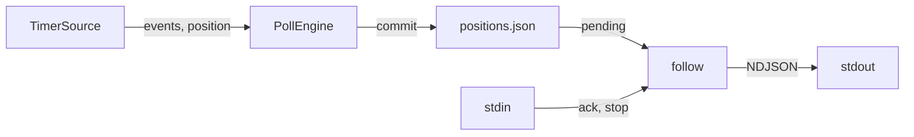

# Rust core

**Status: Implemented** in core-v0.1.0-rc.1. `sourcefed-core` is a Rust crate
and a binary that follows a timer, delivers each event at least once and
resumes from saved state.

## You can

Follow a timer and acknowledge each event once your program has handled it.

```sh
sourcefed-core follow --job deploy --every 5 \
  --state-dir ./state --max-polls 20
```

Five seconds in, stdout prints one JSON line:

```json
{
  "id": "timer:deploy:2026-11-26T09:00:05Z",
  "kind": "timer.fired",
  "subject": { "source": "timer", "key": "deploy" },
  "summary": "timer deploy fired at 2026-11-26T09:00:05Z",
  "at": "2026-11-26T09:00:05Z"
}
```

Write `ack timer:deploy:2026-11-26T09:00:05Z` on stdin and the event never
returns. Write `stop` and the run ends. Run the command again over the same
`./state` folder: events never acknowledged print again, once each, and
firings that fell due in between follow.



## Recording

The recording runs the released tarball. It follows a timer, prints a fired
event and acknowledges it, then restarts on the same state, where the pending
events return and the acknowledged one does not.


## What it builds

### 1. Model

Validated values for events, monitors, positions and sources. Each wraps a
string or number and refuses what breaks its rule when it is built or
deserialized, so no invalid value exists inside the crate. Events compare and
hash by ID alone.

Files: `rust/crates/core/src/event.rs`, `monitor.rs`, `position.rs`,
`source.rs`.

```rust
let source = SourceName::new("timer".into())?;
let at = "2026-11-26T09:00:05Z".parse()?;
let id = EventId::derive(&source, "deploy", at)?;

assert_eq!(id.as_str(), "timer:deploy:2026-11-26T09:00:05Z");
```

**Structure.** An event is an ID, a kind with a dotted wire name, a subject, a
one-line summary and an instant. Construction refuses an empty, oversized or
control-containing summary.

```rust
pub struct Event { … }

impl Event {
    pub fn new(
        id: EventId,
        kind: EventKind,
        subject: EventSubject,
        summary: String,
        at: Timestamp,
    ) -> Result<Self, ModelError>;
}

pub enum EventKind {
    TimerFired,
    TimerMissed,
}
```

A source receives a request and returns an outcome of at most 100 events, the
position to save and what happens next. `Done` ends the monitor.

```rust
pub trait Source: Send + Sync {
    fn name(&self) -> &SourceName;
    fn poll(&self, request: PollRequest) -> Result<PollOutcome, PollError>;
}

pub enum Next {
    Due(Timestamp),
    Done,
}
```

**Verified by** unit tests at each length boundary, tests of the exact JSON
wire shape and a property test that an accepted ID keeps its input.

### 2. Store

One JSON file per state folder holds three things for each position key: the
position, the remembered event IDs and the pending queue. A commit writes all
three together to a temporary file, syncs it and renames it into place. An
exclusive lock admits one writer per folder.

Files: `rust/crates/core/src/store.rs`.

```rust
let mut store = Store::open(Path::new("./state"))?;

store.commit(key.clone(), position, &events)?;
store.ack_pending(&key, &[id])?;
```

**Structure.** A full pending queue refuses fresh events until some are
acknowledged. At the ID limit the oldest ID with no pending event is dropped.
An acknowledgement removes the event and keeps its ID.

```rust
pub struct Store { … }

impl Store {
    pub fn open(dir: &Path) -> Result<Self, StoreError>;
    pub fn pending(&self, key: &PositionKey) -> Option<&VecDeque<Event>>;
    pub fn commit(
        &mut self,
        key: PositionKey,
        position: Position,
        events: &[Event],
    ) -> Result<usize, StoreError>;
    pub fn ack_pending(
        &mut self,
        key: &PositionKey,
        ids: &[EventId],
    ) -> Result<usize, StoreError>;
}
```

`open` refuses a corrupt file, a version other than 2 and a folder another
store holds, and never rewrites what it refuses.

**Verified by** tests that state survives a reopen, that a full queue refuses
a commit and leaves the file unchanged, that eviction never drops a pending
ID, that a second open is locked and that leftover temporary files are cleaned
within their limits.

### 3. Poll engine

The engine polls one source, commits each outcome to the store and sleeps in
short steps so a stop lands quickly. A failed poll retries with a doubling
delay that has a cap. A clock reading outside the timestamp range stops the
engine or defers the poll; it never counts as due.

Files: `rust/crates/core/src/poll.rs`.

```rust
let mut engine = PollEngine::new(config, source, store, Arc::new(SystemClock))?;
let stop = engine.handle();

let state = engine.run(1)?;
let queued = engine.pending();
```

**Structure.** `run` makes at most `max_polls` polls inside a bounded number
of wait steps and returns the state it observed.

```rust
pub struct PollEngine { … }

impl PollEngine {
    pub fn new(
        config: MonitorConfig,
        source: Arc<dyn Source>,
        store: Store,
        clock: Arc<dyn Clock>,
    ) -> Result<Self, ModelError>;
    pub fn run(&mut self, max_polls: u32) -> Result<EngineState, EngineError>;
    pub fn ack(&mut self, ids: &[EventId]) -> Result<usize, StoreError>;
}

pub enum EngineState {
    Running,
    Stopped,
    Ended,
}
```

**Verified by** tests with a fake clock and source: the first poll runs at
once, sleeps are bounded, a late clock catches up with one poll, retries double
to the cap and reset on success, and a stop during a sleep prevents the next
poll.

### 4. CLI and delivery

`follow` runs the engine one poll at a time. After each poll it prints every
pending event not yet printed, as one JSON line. A reader thread parses stdin
into `ack <id>` and `stop` lines. The reader keeps a bounded queue, discards
lines over 512 bytes and ends when its discard budgets run out.

Delivery is at least once: pending events are saved, so every event not
acknowledged prints again after a restart. An acknowledgement that arrives
while the run is stopping may be lost, and its event is delivered again.

Files: `rust/crates/cli/src/main.rs`.

```sh
printf 'ack timer:deploy:2026-11-26T09:00:05Z\nstop\n' |
  sourcefed-core follow --job deploy --every 5 \
    --state-dir ./state --max-polls 20
```

The run prints `ack …: 1 event(s) removed` on stderr and exits 0.

**Structure.** The binary has one subcommand.

```rust
struct Follow {
    job: String,
    every: u64,
    state_dir: PathBuf,
    max_polls: u32,
}

enum Input {
    Ack(EventId),
    Stop,
}
```

**Verified by** unit tests of the reader's bounds and of how a run applies
queued inputs when it ends, and an integration test that runs the built binary
against a real state folder. In it an acknowledged event never prints after a
restart, unacknowledged ones print again once each in order, and a stop ends
the run within one poll.

### 5. Timer source

`TimerSource` fires a named job every interval. Its position is the next due
instant, so a source rebuilt from the same position derives the same IDs. The
first poll saves the first due instant and emits nothing. A later poll emits
one event per firing due, oldest first. When more firings fall due than one
poll reports, one `timer.missed` event stands for all of them.

Files: `rust/crates/core/src/sources/timer.rs`.

```rust
let timer = TimerSource::new("deploy".into(), 5)?;

assert_eq!(timer.name().as_str(), "timer");
```

**Structure.** The interval is 1 to 3600 seconds. The job becomes the subject
key and the middle of each event ID, and it cannot contain a colon.

```rust
pub struct TimerSource { … }

impl TimerSource {
    pub fn new(job: String, every_secs: u64) -> Result<Self, ModelError>;
}

impl Source for TimerSource {}
```

**Verified by** tests of the first poll, an early poll, an on-time poll, a late
poll that catches up, the cap at 100 firings, a rebuilt source that derives the
same IDs and a position that does not parse.

### 6. Release

A tag named `core-v<version>` builds the `sourcefed-core` binary, checks the
tag against the package version and smoke-tests the packed tarball outside the
checkout. A recording job films the packed binary with `termctrl` in two
takes that share one state folder, and joins them into `demo.gif`. The release
job attaches the tarball, the GIF and `SHA256SUMS` to a prerelease that is
never marked latest. A manual run on an existing tag replaces the GIF and the
sums and leaves the tarball.

Files: `.github/workflows/rust-release.yml`.

**Verified by** the smoke test, which runs `--version` and `follow`, requires a
`timer.fired` event and requires unique IDs. The recording job checks each
take's frames, that the restart prints each pending ID once and never the
acknowledged one, that a firing from the downtime arrives, and that OCR of the
GIF finds both takes and a GIF under 3 MB.

## End to end

- Format, `cargo deny`, clippy with warnings denied, nextest, doc tests, docs
  and a check on the pinned toolchain pass in the `rust` job.
- Mutation testing over the pull request's diff catches every viable mutant.
- The release workflow runs on tag `core-v0.1.0-rc.1` and publishes
  `sourcefed-core-0.1.0-rc.1-x86_64-unknown-linux-gnu.tar.gz`, `SHA256SUMS`
  and `demo.gif` as a prerelease.
- `sha256sum -c SHA256SUMS` passes, and `sourcefed-core --version` prints
  `sourcefed-core 0.1.0-rc.1`.
- `demo.gif` shows the sequence in [Recording](#recording).
