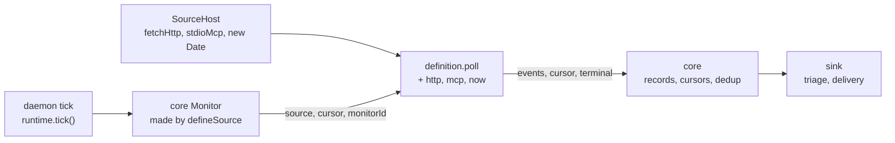
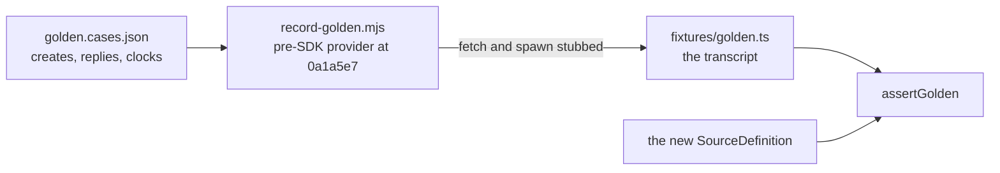

# P0: the SDK and golden tests

**Status: Implemented** in [0.6.0-rc.1]. The SDK and all seven ports are on main
([#37], [#38], [#39], [#40] and [#41]). Part of the plan in [#31]; the other
slices are listed in the [index](README.md).

## You can

Nothing changes for a user. All seven built-in sources (jira, jira-query,
github, github-issues, slack, yab, schedule) run as definitions on
`@sourcefed/sdk`, and each is proven to behave exactly as it did before.

```ts
export const jiraSource: SourceDefinition<JiraSourceRecord> = {
  type: "jira",
  schema: JiraSourceSchema,
  cursor: JiraCursorSchema,
  input: { description: "…", properties: { … }, required: ["issueKey"] },
  build: (input) => …,
  key: (source) => `jira:${source.issueKey}`,
  label: (source) => source.issueKey,
  detail: (source) => ` ${source.issueKey}`,
  describe: (source) => `Jira ${source.issueKey}`,
  poll: async ({ source, cursor, http }) => {
    const result = await pollJira(http, source.issueKey, cursor)

    return {
      cursor: result.cursor,
      events: result.events.map((event) => toMonitorEvent(event, source)),
      terminal: result.terminal,
    }
  },
}

export const JiraMonitor = defineSource(jiraSource)
```

`JiraMonitor` is the core `Monitor` the daemon's registry holds under `jira`.

## The path of a poll

`defineSource` returns a core `Monitor`, so the daemon, the store, the webhook
router and `runtime.tick()` run it as they run any monitor. The definition's
`poll` receives the host's seams; the events and cursor it returns go back to
core.



A port is proven by replaying a transcript recorded from the code before the
SDK. The recorder runs the pre-SDK provider at `0a1a5e7` in a temporary
worktree with `fetch` and `spawn` stubbed in-process and a fixed clock per case.



## Recording

The recording shows the released 0.6.0-rc.1 acting on two real events in
OpenCode, on a free model. A `github-issues` monitor created with
`includeExisting` reads the public `wrkhse/sourcefed` issues labelled `plan`,
and its first poll sends `item.matched` for [#3], "Plan: sources for programs:
issue collections, Jira queries and schedules". A `schedule` monitor on
`* * * * *` UTC sends `schedule.fired` at 2026-11-19T03:32:00+00:00. For each
event the model reads the title or the instant, explains it, then calls
`monitor_status` and `monitor_stop`: the monitor's `enabled` goes from true to
false. The lower pane is the daemon's monitor log, whose event timestamps
match the events above it. The wait between the two events is cut.


The recording proves two real paths, github-issues and schedule, through the
installed candidate. The golden fixtures prove all seven sources; the recording
does not show every one.

## What it builds

### `defineSource` and `SourceDefinition`

A source is a definition plus a poll function. `defineSource` wraps it in a core
`Monitor` and reads the definition nowhere else. Every provider keeps its
exported name: the definition (`jiraSource`) and the monitor built from it
(`JiraMonitor`), and `SOURCE_MAP` in `packages/daemon/src/registry.ts` maps
each type to its monitor.

Files: `packages/sdk/src/source.ts`, `packages/sdk/src/index.ts`.

```ts
const monitor = defineSource(jiraSource)
const source = monitor.build({ issueKey: "PROJ-1" })

monitor.key(monitor.validateSource(source))
// "jira:PROJ-1"

// A test supplies its own seams:
defineSource(jiraSource, { http, mcp, now })
```

**Structure.** A definition is its type and schemas, its create input, its
display, and its poll. `cursor` is the shape of the cursor the source stores
under its key; a stored cursor is checked against it, and a later change of
shape is a migration the source declares. `build` receives the host's clock, so
a source that resolves relative input, such as a timer's `in`, reads it there.

```ts
export type SourceDefinition<T extends MonitorSource> = {
  readonly type: T["type"]
  readonly schema: GenericSchema<T>
  readonly cursor: GenericSchema<unknown>
  readonly input: SourceInputSchema
  readonly build: (input: MonitorCreateInput, now: () => Date) => SourceInput
  readonly key: (source: T) => string
  readonly label: (source: T) => string
  readonly detail: (source: T) => string
  readonly describe: (source: T) => string
  readonly icon?: string
  readonly poll: (context: SourceContext<T>) => Promise<SourcePollResult>
}
```

Four optional members shape the monitor beyond a plain poll.
`defaultPollIntervalSec` is how often a new monitor polls when the caller names
no interval (schedule sets `15`). `wake` is a webhook that only wakes the
monitor for an early poll (github-issues). `webhook` delivers events itself
(github, slack). `mergeCursor` merges a poll's cursor into the stored one, so a
poll does not replace what a delivery wrote while it ran (github); without it a
poll's cursor replaces the stored one.

```ts
readonly defaultPollIntervalSec?: number
readonly wake?: MonitorWake<T>
readonly webhook?: SourceWebhook
readonly mergeCursor?: (current: unknown, result: unknown) => unknown
```

A poll receives its context, and `defineSource` receives the host.

```ts
export type SourceContext<T extends MonitorSource> = {
  readonly source: T
  readonly cursor: unknown
  readonly monitorId: string
  readonly http: Http
  readonly mcp: Mcp
  readonly now: () => Date
}

export type SourceHost = {
  readonly http: Http
  readonly mcp: Mcp
  readonly now: () => Date
}

export function defineSource<T extends MonitorSource>(
  definition: SourceDefinition<T>,
  host?: SourceHost,
): Monitor<T>;
```

Without a `host`, `defineSource` uses `fetchHttp()`, `stdioMcp(hostMcpServers)`
and `new Date()`.

**Verified by** `packages/sdk/src/source.test.ts`, and by every golden replay,
which builds each port through `defineSource`.

### The host's seams: `http`, `mcp` and `now`

A poll gets no timer, no store and no secret: only these three. A test or the
golden harness supplies its own.

Files: `packages/sdk/src/http.ts`, `packages/sdk/src/mcp.ts`.

```ts
const issue = await http.json<Issue>(url, { headers })
const reply = await http.fetch(url, { method: "POST", headers, body })

const page = await mcp.call("yab", "fetch", { url: source.url, html: true })

const at = now().toISOString()
```

**`http`.** `fetch` answers as the upstream answered (status, headers, body)
and rejects as `fetch` does, so a provider keeps its own status handling.
`json` reduces a request to its JSON or an `HttpError` whose `failure` is
`transport` (the request rejected), `status` (not ok, with `status`) or
`body` (not JSON). `fetchHttp` calls whatever `globalThis.fetch` is at each
request; `httpOver` gives the replay the same `json` rule.

```ts
export type Http = {
  fetch(url: string, init?: HttpRequest): Promise<Response>
  json<T = unknown>(url: string, init?: HttpRequest): Promise<T>
}

export class HttpError extends Error {
  readonly failure: "transport" | "status" | "body"
  readonly status?: number
}

export function fetchHttp(fetchImpl?: typeof fetch): Http;
export function httpOver(
  send: (url: string, init?: HttpRequest) => Promise<Response>,
): Http;
```

**`mcp`.** A source never starts a process: it names a server the host runs and
calls one of its tools, and gets the tool's text parts joined by newlines. Yab
is the host's only server; `hostMcpServers` runs it from
`SOURCEFED_YAB_COMMAND`, read at each call, or the app's own binary, with a 45 s
limit per call. `stdioMcp` speaks MCP over stdio and starts one process per
call, stopped once the call settles. A server the host does not run rejects
with a plain `Error`: that is a configuration bug, not a failed call.

```ts
export type Mcp = {
  call(
    server: string,
    tool: string,
    args: Readonly<Record<string, unknown>>,
  ): Promise<string>
}

export function stdioMcp(
  servers: (name: string) => McpServer | undefined,
  spawnChild?: McpSpawn,
): Mcp;

export function hostMcpServers(name: string): McpServer | undefined;
```

A call that produces no text rejects with an `McpError`. The server's own
words (its stderr, its error's message, or the tool's failure text) are in
`detail` and never in `message`, because they can quote what the source sent,
such as a feed URL whose path is its credential.

An `error` from the child means one of two things. Before the child has
started (node's `spawn` event, or any output) there is no process, so the call
answers `start` at once, naming the command. After it the process is still
there, so the call answers `broken`, "yab failed while answering", with the
error's message in `detail`, and stops the child as any settled call does.

```ts
export type McpFailure =
  "start" | "broken" | "timeout" | "exit" | "error" | "tool" | "overflow"

export class McpError extends Error {
  readonly failure: McpFailure
  readonly code?: number | string
  readonly exitCode?: number | null
  readonly command?: string
  readonly timeoutMs?: number
  readonly limitBytes?: number
  readonly detail: string
}
```

Each call is bounded:

| Bound | Value |
| --- | --- |
| Output not yet ended by a newline | past 16 MiB the call fails with `overflow` |
| Stderr kept as `detail` | its first 4096 characters |
| A settled call's child | SIGTERM, then SIGKILL two seconds later |
| The answer | when the child exits, or two seconds after SIGKILL whatever happens |
| A call's total time | at most `timeoutMs` plus four seconds |

Stderr keeps 4096 characters, not the 300 a source quotes, because a source
redacts before it quotes: text cut before redaction could end inside a URL and
leave a credential that no longer looks like one. 4096 leaves redaction whole
text to work on and still bounds memory.

Once a call answers, it removes the listeners it put on the child and its
streams, so nothing the child does afterwards reaches it. Node's own listeners
stay, and a late `error` lands in a listener that ignores it, since an error
event with no listener throws.

**`now`.** The clock a source stamps events with. The host passes
`new Date()`; a recorded poll replays at its recorded instant.

**Verified by** `http.test.ts` and `mcp.test.ts` in `packages/sdk/src`: a line
split across chunks, each bound, the signal order, a child that never exits, an
error before and after the child started, and late events after the answer.
The "Yab MCP client" tests in `providers/yab/src/yab.test.ts` run the same
client against a fake Yab started as a real process, including a child that
ignores SIGTERM.

### Webhooks

A definition's `webhook` takes the options of core's `WebhookMonitor` (`path`,
`configured`, `deliveryId`, `eventName`, `challenge`, `updateCursor`, …), and
`defineSource` builds one from it, so the daemon routes, retries and heartbeats
it as it does core's. `verify` and `parse` also receive the host's clock: a
signature's age and an event's fallback time are judged by the host, so a
recorded delivery replays at its recorded instant.

Files: `packages/sdk/src/source.ts`; the webhooks of `providers/github` and
`providers/slack`.

```ts
webhook: {
  path: "/webhooks/slack",
  preferred: true,
  configured: () => Boolean(process.env.SOURCEFED_SLACK_SIGNING_SECRET),
  verify: (body, request, now) => validSlackSignature(body, request, now),
  acknowledgeBeforeDelivery: true,
  deliveryId: (_request, payload) => payload.event_id,
  eventName: () => "slack",
  parse: parseSlackWebhook,
  updateCursor: updateSlackCursor,
  …
},
```

**Structure.**

```ts
export type SourceWebhook = Omit<WebhookMonitorOptions, "verify" | "parse"> & {
  readonly verify: (body: string, request: Request, now: () => Date) => boolean
  readonly parse: (
    payload: unknown,
    eventName: string,
    deliveryId: string,
    now: () => Date,
  ) => MonitorEvent | undefined
}
```

**Verified by** the recorded deliveries: github's `bad-signature`, `review`,
`ping` and `merged`, and slack's `url-verification`, `thread-message`, `stale` and
`dm-without-time`.

### The golden harness

A fixture is what the pre-SDK tree did. Each case holds the create input, the
starting cursor, the upstream replies in order, the redacted requests the
source made, and the display, input schema, events and cursor the core
`Monitor` returned. `assertGolden` replays the cases in order and names the
provider and case on the first difference. It also requires a recorded cursor
to parse against the definition's `cursor`.

Files: `packages/sdk/src/golden.ts`, `providers/*/src/golden.test.ts`.

```ts
test("the jira source replays its recorded transcript", async () => {
  await withEnvironment({ ATLASSIAN_API_KEY: "test-key" }, async () => {
    await assertGolden(JIRA_GOLDEN, jiraSource)
  })
})
```

`withEnvironment` sets each variable (`undefined` removes one) for the run and
puts every one back afterwards, even when the run throws.

A case may give its own `now`, an ISO instant that overrides the fixture's, so
a source that reads the clock between cases (a schedule, a rate limiter, a
signature's age) replays at the instants it was recorded at. A case may also
carry `mcpReplies` and `mcpCalls`: the replay runs the real `stdioMcp` against
`fakeMcpSpawn`, a server that answers over in-memory streams with no process,
and asserts the calls equal the recorded ones. A source that calls more tools
than the case has replies fails with code `golden:no-reply`.

**Structure.** A fixture is its cases and, for a source with a webhook, its
recorded deliveries.

```ts
export type GoldenFixture = {
  readonly provider: string
  readonly recordedFrom: string
  readonly base: string
  readonly now?: string
  readonly cases: readonly GoldenCase[]
  readonly webhook?: GoldenWebhook
}

export type GoldenWebhook = {
  readonly path: string
  readonly preferred: boolean
  readonly acknowledgeBeforeDelivery: boolean
  readonly configured: boolean
  readonly cases: readonly GoldenWebhookCase[]
}
```

A case records what went in and what came out: `events`, `cursorAfter` and
`terminal` for a poll that returns, `deferred` for one that defers, `error` for
one that throws.

```ts
export type GoldenCase = {
  readonly name: string
  readonly now?: string
  readonly build: GoldenCreateInput
  readonly cursor: unknown
  readonly replies: readonly GoldenReply[]
  readonly requests: readonly GoldenRequest[]
  readonly mcpReplies?: readonly GoldenMcpReply[]
  readonly mcpCalls?: readonly GoldenMcpCall[]
  readonly source: Readonly<Record<string, unknown>>
  readonly key: string
  readonly label: string
  readonly detail: string
  readonly describe: string
  readonly icon: string
  readonly defaultPollIntervalSec?: number
  readonly schema: SourceInputSchema
  readonly events?: readonly unknown[]
  readonly cursorAfter?: unknown
  readonly terminal?: boolean
  readonly error?: string
  readonly deferred?: true
}
```

`webhookSteps` runs what core's `handleWebhook` does to a delivery, stopping
where it stops: `verified`, then `challenge`, `deliveryId`, `eventName`, the
parsed `event` and the `cursorAfter` that `updateCursor` would write. The
recorder and the replay both call it, so the two cannot drift.

```ts
export function assertGolden<T extends MonitorSource>(
  fixture: GoldenFixture,
  definition: SourceDefinition<T>,
): Promise<void>;

export function webhookSteps(
  webhook: WebhookMonitor<any>,
  delivery: { name; now?; headers; body; cursor },
  path: string,
): GoldenWebhookCase;

export function withEnvironment<T>(
  variables: Readonly<Record<string, string | undefined>>,
  run: () => Promise<T>,
): Promise<T>;
```

The harness also exports `fakeMcpSpawn`, `scriptedHttp`, `goldenRequest`,
`replyResponse` and `redactHeaders`, which the recorder shares with the replay.

**Verified by** `packages/sdk/src/golden.test.ts`, and by each provider's own
`golden.test.ts`.

### The recorder

`scripts/record-golden.mjs` writes a fixture from a cases file and a git ref.
It creates a temporary detached worktree at the ref, bundles the old provider
from it on its own core, stubs `fetch` with the cases file's replies, and
records each case's requests, events, cursor and terminal flag, or its error.
For the whole run node's `spawn` is replaced in-process: a case with
`mcpReplies` is answered by `fakeMcpSpawn`, and in any other case starting a
process throws, so the attempt is recorded as the case's error. No live API is
contacted and no process starts beyond `git` and esbuild's service.

```sh
node scripts/record-golden.mjs \
  providers/schedule/src/fixtures/golden.cases.json 0a1a5e7
```

The cases file names the `provider`, the old provider's `entry` and `export`,
the output `fixture` and the API `base`; its `env` values and `unset` names
configure the provider before import, and an optional `now` fixes
`new Date()` and `Date.now()`. Each case has a `name`, a `build` and its ordered
`replies`.

```json
{
  "name": "on-time",
  "now": "2026-11-18T13:00:45.000Z",
  "continues": true,
  "build": { "name": "backup", "sourceType": "schedule", … },
  "replies": []
}
```

A case without `continues` is a first poll: it runs with an absent cursor and
records `cursor: null`. A case with `continues: true` starts at the preceding
case's returned cursor, so it cannot follow an error or a deferred case. A
`webhooks` list records deliveries to the old monitor's `webhook` after the
poll cases, each with its exact `body` string so a signature in `headers` stays
valid.

To check a committed fixture, re-run the recorder at its `recordedFrom` and
confirm the bytes are unchanged:

```sh
node scripts/record-golden.mjs \
  providers/jira/src/fixtures/golden.cases.json 0a1a5e7
git diff --exit-code -- providers/jira/src/fixtures/golden.ts
```

The recorder exports nothing; its input is the cases file and its output is the
fixture and a sha256 line.

**Verified by** re-recording each fixture at `0a1a5e7` and a clean
`git diff --exit-code`.

### The seven ports

Each provider is a definition in its own package under its exported name. All
fixtures are recorded from `0a1a5e7`.

| Source | Cases | Fixture |
| --- | --- | --- |
| jira | 6 | `providers/jira/src/fixtures/golden.ts` |
| jira-query | 4 | `providers/jira/src/query/fixtures/golden.ts` |
| github | 6, 4 deliveries | `providers/github/src/fixtures/golden.ts` |
| github-issues | 5 | `providers/github/src/issues/fixtures/golden.ts` |
| slack | 5, 4 deliveries | `providers/slack/src/fixtures/golden.ts` |
| yab | 8, through MCP | `providers/yab/src/fixtures/golden.ts` |
| schedule | 4, a clock per case | `providers/schedule/src/fixtures/golden.ts` |

What the cases cover:

- **jira:** priming, a comment, a status change, a rate limit.
- **jira-query:** priming, a change, a paged existing set, an unbounded query.
- **github:** priming, a review with comments, a CI failure, a conflict, a
  merge, a rate limit; deliveries: bad signature, review, ping, merged.
- **github-issues:** priming, not modified, a change, a search, a rate limit.
- **slack:** thread and DM priming and replies, a rate limit; deliveries: URL
  verification, thread message, stale, DM without time.
- **yab:** priming, a new entry, an undated entry, a filter, sign-in, a tool
  failure, an RPC error.
- **schedule:** priming, on time, missed, late single.

### The `monitors.json` audit

`packages/daemon/src/monitors-audit.test.ts` checks that a monitor stored by the
code before the SDK still works after it. For each of the seven sources it takes
the last cursor the recorded pre-SDK poll wrote, under the key that code
computed at `0a1a5e7`, and builds one monitor record from it. The records are
what the old daemon would have stored; the live state is never read.

The test saves the seven records through `JsonMonitorStore` into a temporary
folder and loads them with a fresh store, so the file format round-trips. For
each loaded record it requires:

- the SDK source's `key` to equal the recorded key;
- a cursor stored under that key;
- that cursor to parse with the source's `cursor` schema.

It also requires every entry of `SOURCE_TYPES` to be covered, so a new source
cannot skip the audit. The keys it checks:

- `jira:PROJ-9`
- `jira-query:project = PROJ AND labels = agent`
- `github:example-org/example-repo#7`
- `github-issues:example-org/example-repo:agent:::milestone:v2`
- `slack:D999`
- `yab:Personal:https://mail.google.com/mail/u/0/feed/atom`
- `schedule:backup:30 * * * *:Asia/Kolkata`

What it proves: the records the pre-SDK code writes keep their keys under the
SDK, and their cursors parse. It does not by itself cover every existing
install's file, since it builds its records from the recorded polls and reads no
install.

One live install was checked once, by hand. A read-only copy of one owner's
`monitors.json`, 81 records (github 28, jira 24, slack 26, yab 3), was checked
against the new definitions with the same rules: 73 passed, 8 had never been
polled and had no cursor yet (github 1, slack 7), and none failed. The registry
schema passed. The file had no jira-query, github-issues or schedule monitors.
No value was recorded, and the copy was deleted.

**Verified by** the test itself, which runs in `npm run check`.

## End to end

The checks in the real environment:

- CI's `npm run check` builds the workspace, runs every golden replay and the
  stored-monitor audit under `node --test`, and typechecks.
- The "Pi integration" job runs the Pi hosts on the locked development host and
  on Pi 0.83.0.
- The "Yab MCP client" tests run the stdio client against a real fake Yab
  process.
- The release candidate, installed from its released tarball and recorded.
  The tarball is checked against the release's `SHA256SUMS` and this digest:

  ```text
  45362b000a0594c973be540eed443d3e4a330b128c8933b21e594be427a34073  fdcn-sourcefed-0.6.0-rc.1.tgz
  ```

  The daemon runs in a disposable `node:24` container with no host mounts and no
  published ports, behind a bearer token: `/rpc` answers 401 without it and 200
  with it, listing all seven source types. OpenCode 2.3.0 runs on the Mac with
  `--standalone`, a scratch project and model `opencode-go/hy4-flash-free`; its
  `/plugins` list shows the candidate's `sourcefed` server plugin and
  `sourcefed-tui` and no other non-built-in plugin. See the [recording](#recording)
  and the [release][0.6.0-rc.1].

[#31]: https://github.com/wrkhse/sourcefed/issues/31
[#37]: https://github.com/wrkhse/sourcefed/pull/37
[#38]: https://github.com/wrkhse/sourcefed/pull/38
[#39]: https://github.com/wrkhse/sourcefed/pull/39
[#40]: https://github.com/wrkhse/sourcefed/pull/40
[#41]: https://github.com/wrkhse/sourcefed/pull/41
[#3]: https://github.com/wrkhse/sourcefed/issues/3
[0.6.0-rc.1]: https://github.com/wrkhse/sourcefed/releases/tag/v0.6.0-rc.1