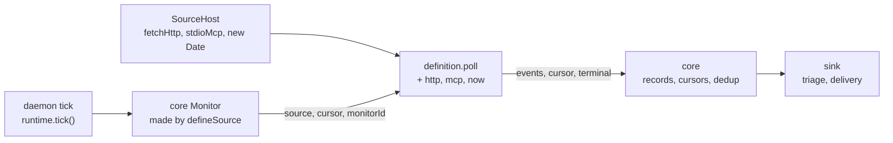

# P0: the SDK and golden tests

**Status: Implemented** in [0.6.0-rc.1]. The SDK and all seven ports are on main
([#37], [#38], [#39], [#40] and [#41]). The closed [#31] records the migration
scope.

## You can

The seven built-in sources (jira, jira-query, github, github-issues, slack,
yab and schedule) run as definitions on `@sourcefed/sdk`. Their recorded
transcripts verify the ports' observable behavior.

See the [SDK README](../../packages/sdk/README.md) for source authoring,
interfaces, [golden transcripts][golden] and the [recorder][recorder].

## The path of a poll

`defineSource` returns a core `Monitor`, so the daemon, the store, the webhook
router and `runtime.tick()` run it as they run any monitor. The definition's
`poll` receives the host's seams; the events and cursor it returns go back to
core.



Each port replays a transcript recorded at `0a1a5e7`. The
[golden harness][golden] and [recorder][recorder] provide deterministic
upstream replies and clocks for the comparison.

## Recording

The recording shows the released 0.6.0-rc.1 acting on two real events in
OpenCode, on a free model. A `github-issues` monitor created with
`includeExisting` reads the public `wrkhse/sourcefed` issues labelled `plan`,
and its first poll sends `item.matched` for [#3], "Plan: sources for programs:
issue collections, Jira queries and schedules". A `schedule` monitor on
`* * * * *` UTC sends `schedule.fired` at 2026-11-19T03:32:00+00:00. For each
event the model reads the title or the instant, explains it, then calls
`monitor_status` and `monitor_stop`: the monitor's `enabled` goes from true to
false. The lower pane is the daemon's monitor log, whose event timestamps
match the events above it. The wait between the two events is cut.


The recording proves two real paths, github-issues and schedule, through the
installed candidate. The golden fixtures prove all seven sources; the recording
does not show every one.

## What it builds

### SDK and golden harness

The daemon registry holds the monitors that `defineSource` returns.

Files: `packages/sdk/src/`, `scripts/record-golden.mjs` and
`providers/*/src/**/golden.test.ts`.

**Structure.** `defineSource` wraps a definition in a core `Monitor`; without a
host it uses `fetchHttp()`, `stdioMcp(hostMcpServers)` and `new Date()`.

```ts
export type SourceHost = {
  readonly http: Http
  readonly mcp: Mcp
  readonly now: () => Date
}

export function defineSource<T extends MonitorSource>(
  definition: SourceDefinition<T>,
  host: SourceHost = { … },
): Monitor<T>;
```

**Verified by** `packages/sdk/src/{source,http,mcp,golden}.test.ts` and each
provider's golden replay.

### The seven ports

Each provider is a definition in its own package under its exported name. All
fixtures are recorded from `0a1a5e7`.

| Source | Cases | Fixture |
| --- | --- | --- |
| jira | 6 | `providers/jira/src/fixtures/golden.ts` |
| jira-query | 4 | `providers/jira/src/query/fixtures/golden.ts` |
| github | 6, 4 deliveries | `providers/github/src/fixtures/golden.ts` |
| github-issues | 5 | `providers/github/src/issues/fixtures/golden.ts` |
| slack | 5, 4 deliveries | `providers/slack/src/fixtures/golden.ts` |
| yab | 8, through MCP | `providers/yab/src/fixtures/golden.ts` |
| schedule | 4, a clock per case | `providers/schedule/src/fixtures/golden.ts` |

What the cases cover:

- **jira:** priming, a comment, a status change, a rate limit.
- **jira-query:** priming, a change, a paged existing set, an unbounded query.
- **github:** priming, a review with comments, a CI failure, a conflict, a
  merge, a rate limit; deliveries: bad signature, review, ping, merged.
- **github-issues:** priming, not modified, a change, a search, a rate limit.
- **slack:** thread and DM priming and replies, a rate limit; deliveries: URL
  verification, thread message, stale, DM without time.
- **yab:** priming, a new entry, an undated entry, a filter, sign-in, a tool
  failure, an RPC error.
- **schedule:** priming, on time, missed, late single.

### The `monitors.json` audit

The [SDK README's audit section][audit] describes the stored-monitor check.
It covers keys and cursor schemas for the seven recorded sources; it does not
read a live installation.

Files: `packages/daemon/src/monitors-audit.test.ts`.

**Structure.** The audit round-trips recorded monitor records through
`JsonMonitorStore` and checks the loaded records against their definitions.

**Verified by** the audit in `npm run check`.

## End to end

The checks in the real environment:

- CI's `npm run check` builds the workspace, runs every golden replay and the
  stored-monitor audit under `node --test`, and typechecks.
- The "Pi integration" job runs the Pi hosts on the locked development host and
  on Pi 0.83.0.
- The "Yab MCP client" tests in `providers/yab/src/yab.test.ts` run the stdio
  client against a real fake Yab process.
- The release candidate, installed from its released tarball and recorded.
  The tarball is checked against the release's `SHA256SUMS` and this digest:

  ```text
  45362b000a0594c973be540eed443d3e4a330b128c8933b21e594be427a34073  fdcn-sourcefed-0.6.0-rc.1.tgz
  ```

  The daemon runs in a disposable `node:24` container with no host mounts and no
  published ports, behind a bearer token: `/rpc` answers 401 without it and 200
  with it, listing all seven source types. OpenCode 2.3.0 runs on the Mac with
  `--standalone`, a scratch project and model `opencode-go/hy4-flash-free`; its
  `/plugins` list shows the candidate's `sourcefed` server plugin and
  `sourcefed-tui` and no other non-built-in plugin. See the [recording](#recording)
  and the [release][0.6.0-rc.1].

[golden]: ../../packages/sdk/README.md#golden-transcripts
[recorder]: ../../packages/sdk/README.md#recording-a-fixture
[audit]: ../../packages/sdk/README.md#the-monitorsjson-audit
[#31]: https://github.com/wrkhse/sourcefed/issues/31
[#37]: https://github.com/wrkhse/sourcefed/pull/37
[#38]: https://github.com/wrkhse/sourcefed/pull/38
[#39]: https://github.com/wrkhse/sourcefed/pull/39
[#40]: https://github.com/wrkhse/sourcefed/pull/40
[#41]: https://github.com/wrkhse/sourcefed/pull/41
[#3]: https://github.com/wrkhse/sourcefed/issues/3
[0.6.0-rc.1]: https://github.com/wrkhse/sourcefed/releases/tag/v0.6.0-rc.1