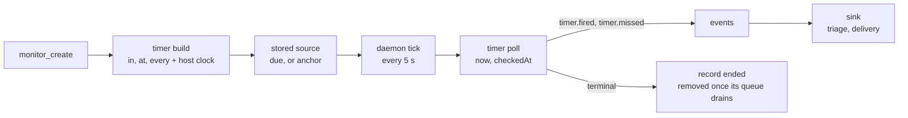
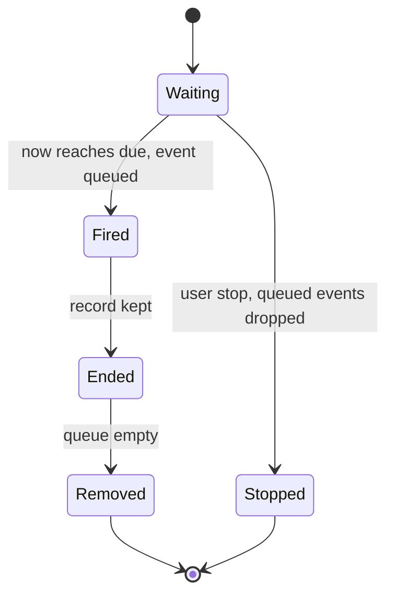

# P1b: timers

**Status: Planned.** Part of the plan in [#31]; it runs in-process on today's
daemon and does not wait for barn. The open question is at the end.

## You can

Set a timer as a monitor. A one-shot (`in: "20m"` or `at: "2026-11-19T15:00"`)
fires once and its monitor ends; an interval (`every: "45m"`) fires on a fixed
phase from creation. Each firing is an event, triaged and delivered like any
other.

```json
{
  "name": "deploy",
  "sourceType": "timer",
  "job": "check the deploy",
  "in": "20m"
}
```

Twenty minutes later, the session receives:

```json
{
  "kind": "timer.fired",
  "at": "2026-11-19T15:20:00+05:30",
  "summary": "Timer check the deploy fired at 2026-11-19T15:20:00+05:30",
  "subject": {
    "type": "timer",
    "key": "check the deploy",
    "job": "check the deploy",
    "at": "2026-11-19T15:20:00+05:30",
    "timezone": "Asia/Kolkata"
  }
}
```

The CLI takes the same input:

```sh
sourcefed monitor create --name deploy --source-type timer \
  --job "check the deploy" --in 20m
```

## The path of a timer

`monitor_create` resolves the timer against the host's clock once and stores the
result. Each daemon tick polls it with the current time, and what it returns goes
through the same sink as every other source.



A one-shot moves through these states. A user's stop at any point before the
queue drains drops what is still queued.



## What it builds

### 1. Terminal events are delivered (core)

A record removed as soon as its poll returns `terminal: true` loses the last
event of a monitor that ends while no session listens, because delivery drops
the queued events of a monitor that is not an enabled record. GitHub's merged
and closed events are among them, so the fix is in core and covers every
source.

`terminal` marks the record ended. The tick skips an ended record. Delivery
treats an ended monitor's queued events as live, and a user's stop still drops
them. The record is removed once its queue is empty: after each acknowledgement
and when the daemon starts. An ended record never counts as active when a
monitor is created.

Files: `packages/core/src/monitors/poll/monitor.ts`,
`packages/core/src/monitors/webhook/monitor.ts`,
`packages/core/src/monitors/poll/utils/tick.ts`,
`packages/core/src/monitors/service.ts`, `packages/daemon/src/daemon.ts`.

```ts
const daemon = new SourcefedDaemon({
  store: new InMemoryMonitorStore(),
  eventQueue: new InMemoryMonitorEventQueue(),
})

await daemon.createMonitor(target, {
  name: "pr",
  sourceType: "github",
  repo: "acme/web",
  prNumber: 42,
})

// The poll returns the merge with terminal: true while no session listens.
// The record is ended and the event waits in the queue.

const late: QueuedMonitorEvent[] = []
daemon.subscribe(target, (events) => late.push(...events))
// late holds the merge event

await daemon.acknowledgeEvents(target, late.map((event) => event.id))
await daemon.listMonitors(target)
// the record is gone
```

**Verified by** a test that fails on the current code: a terminal poll with no
subscriber, a later subscriber that receives the event, and the record removed
after the acknowledgement. Further tests: a user's stop still drops queued
events, an ended record is not polled again, and GitHub's merged case runs
through the daemon.

### 2. `build` receives the host clock (SDK)

`build(input, now)` gets the host's clock, as `verify` and `parse` already do. The
seven existing sources ignore it, so their golden replays stay byte-equal.

Files: `packages/sdk/src/source.ts`, `packages/sdk/src/golden.ts`.

```ts
const monitor = defineSource(timerSource, { http, mcp, now: () => clock })
// clock is 2026-11-19T15:00:00+05:30

monitor.build({
  name: "deploy",
  sourceType: "timer",
  job: "check the deploy",
  in: "20m",
})
// { type: "timer", job: "check the deploy",
//   due: "2026-11-19T15:20:00+05:30", timezone: "Asia/Kolkata" }
```

**Verified by** the SDK tests and every golden replay.

### 3. The timer source (`providers/timer`)

**Input.** Exactly one of `in`, `at` or `every`, and `job`. Durations run from
1 minute to 366 days in the units `m`, `h`, `d` and `w`, which combine
(`"1h30m"`). `at` is local time in `timezone` (an IANA name, the system's by
default) or carries an offset. An `at` already past fires at once; an `at` more
than 366 days ahead is refused. Every refusal names its reason.

```ts
monitor.build({ name: "t", sourceType: "timer", job: "x", in: "30s" })
// { error: "in must be at least 1m" }

monitor.build({ name: "t", sourceType: "timer", job: "x", in: "20m", every: "1h" })
// { error: "give one of in, at or every" }
```

**Resolution.** A one-shot stores `due`. An interval stores `every` and `anchor`,
the creation instant. The key is `timer:<job>:<due>` or
`timer:<job>:<every>:<anchor>`, so two timers created at different times are two
monitors.

For a local `at` that falls in a spring-forward gap, the time moves forward by
the gap; when the clock repeats, the earlier instant is used. Days and weeks in
`every` are calendar steps in the timezone, so 09:00 stays 09:00 across a clock
change. Minutes and hours are elapsed time.

**Poll.** A one-shot fires when `now` reaches `due`: `timer.fired` when it is
within 2 minutes of `due`, otherwise `timer.fired` with `late` and the delay.
Either way the poll is terminal.

An interval computes the firings in (`checkedAt`, `now`] from the anchor and the
period, so a long gap needs no cap. One firing on time is `timer.fired`. More
than one, or a late one, is a single `timer.missed` that names the count and the
latest time. The first poll does not prime: its window starts at the anchor.

An event's id is fixed by its firing, `timer.fired:<key>:<at>`, so a repeat of the
same firing is deduplicated while it waits in the queue. `defaultPollIntervalSec`
is 15.

Files: `providers/timer/src/` (`schema`, `durations`, `zoned`, `firings`, `poll`,
`events`, `monitor` and `index`, each `.ts`), `providers/timer/package.json`,
`packages/daemon/src/registry.ts`,
`packages/daemon/src/dispatch.ts` and its types (`in`, `at` and `every` as
strings), `packages/core/src/types/monitor-create-input.ts`,
`packages/cli/src/commands/monitor/create.ts`, the three tool descriptions
(`packages/mcp/src/server.ts`, `adapters/opencode/tools/monitor_create.ts`,
`adapters/pi/src/index.ts`), Pi's icon map, `scripts/build.mjs`, and the core
skill and README source lists.

```ts
const oneShot = {
  type: "timer",
  job: "check the deploy",
  due: "2026-11-19T15:20:00+05:30",
  timezone: "Asia/Kolkata",
}

pollTimer(oneShot, null, new Date("2026-11-19T15:20:30+05:30"))
// { events: [timer.fired], terminal: true }

pollTimer(oneShot, null, new Date("2026-11-19T18:20:00+05:30"))
// { events: [timer.fired, late 3 h], terminal: true }

const interval = {
  type: "timer",
  job: "stretch",
  every: "45m",
  anchor: "2026-11-19T09:00:00+05:30",
  timezone: "Asia/Kolkata",
}

pollTimer(
  interval,
  { checkedAt: "2026-11-19T09:10:00+05:30" },
  new Date("2026-11-19T12:50:00+05:30"),
)
// { events: [timer.missed, count 5, latest 2026-11-19T12:45:00+05:30],
//   terminal: false }
```

**Verified by**

- Pure unit tests with an injected `now`: parsing and refusals, zoned resolution
  in America/New_York and Asia/Kolkata including the gap on 2026-03-08 and the
  repeat on 2026-11-01, and firings at the window's bounds.
- A restart test with two services over one in-memory store and the source's
  host clock: a one-shot due during the downtime fires once, late, then ends;
  a second restart fires nothing.
- Sleep, as a poll gap.
- An interval across a DST change.
- A CI-only integration script that runs a packed daemon with a real clock
  across a restart.

## End to end

- The tests above on the final tree, with [#29]'s replay fixtures and the seven
  goldens unchanged.
- A release candidate, 0.6.0-rc.2, as a GitHub prerelease.
- A recording of rc.2. In OpenCode the agent sets `in: "1m"` and `every: "1m"`.
  The one-shot fires and its monitor ends; the interval fires twice. The daemon
  stops across a due time and restarts, and that timer fires once, late, and
  never again. The daemon's monitor log shows each event with its real time.
  Waits are cut.

## Known bound

Never twice holds across restarts and sleep. A crash in the instant between the
queue write and the store write, after the session already acknowledged the
event, can repeat it once: closing that needs one transaction across two files,
which this slice does not build.

## Open question

1. The recording's OpenCode runs on the Mac with `--standalone`, the route of the
   rc.1 recording that End to end assumes, or inside the container.

[#29]: https://github.com/wrkhse/sourcefed/pull/29
[#31]: https://github.com/wrkhse/sourcefed/issues/31
