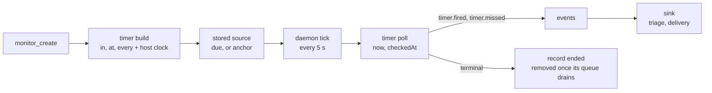
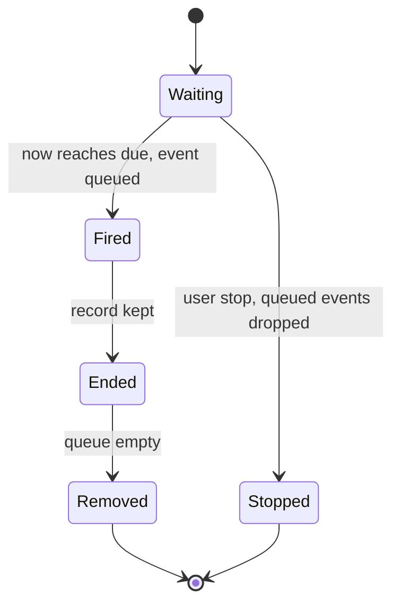

# P1b: timers

**Status: In progress.** Built on main ([#45]–[#49]); the release candidate
0.6.0-rc.2 and its recording are left. Part of the plan in [#31]; it runs
in-process on today's daemon and does not wait for barn.

## You can

Set a timer as a monitor. A one-shot (`in: "20m"` or `at: "2026-11-19T15:00"`)
fires once and its monitor ends; an interval (`every: "45m"`) fires on a fixed
phase from creation. Each firing is an event, triaged and delivered like any
other.

```json
{
  "name": "deploy",
  "sourceType": "timer",
  "job": "check the deploy",
  "in": "20m",
  "timezone": "Asia/Kolkata"
}
```

Twenty minutes later, the session receives:

```json
{
  "kind": "timer.fired",
  "id": "timer:timer:check the deploy:2026-11-19T15:20:00+05:30:2026-11-19T15:20:00+05:30",
  "at": "2026-11-19T15:20:00+05:30",
  "summary": "Timer check the deploy fired at 2026-11-19T15:20:00+05:30",
  "actionable": true,
  "subject": {
    "type": "timer",
    "key": "check the deploy",
    "job": "check the deploy",
    "at": "2026-11-19T15:20:00+05:30",
    "timezone": "Asia/Kolkata"
  }
}
```

The CLI takes the same input:

```sh
sourcefed monitor create --name deploy --source-type timer \
  --job "check the deploy" --in 20m --timezone Asia/Kolkata
```

## The path of a timer

`monitor_create` resolves the timer against the host's clock once and stores the
result. Each daemon tick polls it with the current time, and what it returns goes
through the same sink as every other source.



A one-shot moves through these states. A user's stop at any point before the
queue drains drops what is still queued.



## What it builds

### 1. Terminal events are delivered (core)

A poll or webhook that returns `terminal: true` ends its monitor: the record is
kept, not polled, until the events it queued last are delivered. This covers
every source with a terminal event, GitHub's merged and closed among them, so a
monitor that ends while no session listens still delivers its last event.

The daemon follows three rules:

- **Delivery.** A queued event is delivered while its monitor is enabled or
  ended. A stopped or removed monitor's queued events are dropped.
- **Removal.** An ended record is removed once its target holds no queued event
  of it: after an acknowledgement or a drop, after a user's stop (which drops
  first), when the daemon hears the ending, and when the daemon starts. A
  session may take the last event before the ending is stored, so hearing the
  ending checks again. The check is not atomic with the list; a record it misses
  goes at the next acknowledgement or start.
- **Lists.** `listMonitors` leaves an ended monitor out at once; `getMonitor`
  still finds it while its record lasts. `listTargets` keeps the target of an
  ended monitor whose events wait, so a host that restarts subscribes again and
  receives them.

Files: `packages/core/src/monitors/schema.ts`,
`packages/core/src/monitors/service.ts`,
`packages/core/src/monitors/poll/monitor.ts`,
`packages/core/src/monitors/webhook/monitor.ts`, `packages/daemon/src/daemon.ts`.

```ts
const store = new InMemoryMonitorStore()

const daemon = new SourcefedDaemon({
  store,
  eventQueue: new InMemoryMonitorEventQueue(),
})

await daemon.createMonitor(target, {
  name: "pr",
  sourceType: "github",
  repo: "acme/web",
  prNumber: 42,
})

// A signed pull_request delivery for the merge, while no session listens.
await daemon.webhook(merged)

await daemon.listMonitors(target)
// { ok: true, monitors: [] }; the record has endedAt and the merge waits

const late: QueuedMonitorEvent[] = []
daemon.subscribe(target, (events) => late.push(...events))
// late holds the merge event

await daemon.acknowledgeEvents(target, late.map((queued) => queued.id))

const { monitors } = await store.load()
// monitors is []: the record is gone
```

**Structure.** A record carries `endedAt` once its source says it is finished.
A record stored without it loads unchanged.

```ts
export const MonitorRecordSchema = v.object({
  id: v.string(),
  …
  enabled: v.boolean(),
  …
  endedAt: v.optional(v.string()),
})

export type MonitorRecord = v.InferOutput<typeof MonitorRecordSchema>
```

`end` sets `enabled` to false and stamps `endedAt` in one store write, then calls
each `onEnd` listener with the stored record. A listener that throws is logged
and does not fail the ending, nor the poll or webhook that ended it. `end` of an
unknown id does nothing. `onEnd` returns the function that unsubscribes.
`start` refuses an ended monitor with `monitor <id> has ended`, and `create`
reuses only an enabled monitor, so an ended one never blocks a new one. A
terminal result in core's `PollMonitor` or `WebhookMonitor` calls `end`.

```ts
export type MonitorEndListener = (monitor: MonitorRecord) => void | Promise<void>

export class MonitorService {
  end(id: string): Promise<void>;
  onEnd(listener: MonitorEndListener): () => void;
  start(id: string): Promise<MonitorRecord | { error: string }>;
}
```

**Verified by**

- `packages/daemon/src/terminal-delivery.test.ts`: a merged pull request's
  event reaches a session that subscribes after it; the ended monitor leaves
  the lists at once and the store once its event is acknowledged; a user's
  stop drops its queued event; a restarted host still finds its target; an
  ending heard after its last event was acknowledged removes the record at
  once; stopping it with nothing queued leaves no record; its event waiting
  across a restart arrives once, then the record goes; starting removes ended
  monitors with nothing queued and keeps those with events waiting.
- `packages/core/src/monitors/transport.test.ts`: a terminal poll ends its
  monitor, which is not polled again; an ended monitor cannot be started and
  does not block a new one.
- `packages/core/src/monitors/service.test.ts`: end listeners hear an ending
  after it is stored, and a failing one does not fail it.
- `packages/core/src/storage/json.test.ts`: the JSON store keeps `endedAt`
  across instances and loads a record stored without it.

### 2. `build` receives the host clock (SDK)

`build(input, now)` gets the host's clock, as `poll`, `verify` and `parse` do,
so a source with relative input pins it to an instant when the monitor is
created. The seven existing sources ignore it, so their golden replays stay
byte-equal.

Files: `packages/sdk/src/source.ts`, `packages/sdk/README.md`.

```ts
const monitor = defineSource(timerSource, { http, mcp, now: () => clock })
// clock is 2026-11-19T15:00:00+05:30

monitor.build({
  name: "deploy",
  sourceType: "timer",
  job: "check the deploy",
  in: "20m",
  timezone: "Asia/Kolkata",
})
// { type: "timer", job: "check the deploy",
//   due: "2026-11-19T15:20:00+05:30", timezone: "Asia/Kolkata" }
```

**Structure.** `build` receives the clock as a function, read only when the
source needs it. The monitor `defineSource` returns passes `host.now`, so core's
`Monitor.build` keeps one argument. Without a host, `now` is `new Date()`.

```ts
export type SourceDefinition<T extends MonitorSource> = {
  …
  readonly build: (input: MonitorCreateInput, now: () => Date) => SourceInput
  …
}

export type SourceHost = {
  readonly http: Http
  readonly mcp: Mcp
  readonly now: () => Date
}
```

**Verified by** "builds with the host's clock" in
`packages/sdk/src/source.test.ts`, and every golden replay
(`providers/*/src/golden.test.ts`), unchanged.

### 3. The timer source (`providers/timer`)

**Input.** Exactly one of `in`, `at` or `every`, and `job`. Durations run from
1 minute to 366 days in the units `m`, `h`, `d` and `w`, which combine
(`"1h30m"`). `at` is local time in `timezone` (an IANA name, the system's by
default) or carries `Z` or an offset. An `at` already past fires at once; an
`at` more than 366 days ahead is refused. Every refusal names its reason.

```ts
monitor.build({ name: "t", sourceType: "timer", job: "x", in: "30s" })
// { error: "in must be at least 1m" }

monitor.build({ name: "t", sourceType: "timer", job: "x", in: "20m", every: "1h" })
// { error: "give one of in, at or every" }
```

**Resolution.** A one-shot stores `due`. An interval stores `every` and
`anchor`, the creation instant. The key is `timer:<job>:<due>` or
`timer:<job>:<every>:<anchor>`, so two timers created at different times are two
monitors.

For a local `at` that falls in a spring-forward gap, the time moves forward by
the gap; when the clock repeats, the earlier instant is used. Days and weeks in
`every` are calendar steps in the timezone, so 09:00 stays 09:00 across a clock
change. Minutes and hours are elapsed time.

**Poll.** A one-shot fires when `now` reaches `due`: `timer.fired`, with `late`
and the delay when it is more than 2 minutes past `due`. Either way the poll is
terminal. A late one-shot is `timer.fired` with `late`, because it fires only
once; a late interval firing is `timer.missed`, as schedule's is, because later
firings follow it.

An interval computes the firings in (`checkedAt`, `now`] from the anchor and the
period, so a long gap needs no cap. One firing on time is `timer.fired`. More
than one, or a late one, is a single `timer.missed` that names the count and the
latest time. The first poll does not prime: its window starts at the anchor. An
interval whose cursor is missing or corrupt counts its window from the anchor,
so it gives at most one event, never a flood.

After a sleep, the first poll on wake sees the whole gap: a one-shot due during
it fires once, late, and ends; an interval gives one `timer.missed` for the
firings it slept through.

An event's id is fixed by its firing, `timer:<key>:<at>`, whatever its kind, so
a repeat of the same firing (on time once, late after a restart) is
deduplicated while it waits in the queue. `defaultPollIntervalSec` is 15.

Files: `providers/timer/src/` (`schema`, `durations`, `zoned`, `at`, `build`,
`firings`, `poll`, `events`, `monitor` and `index`, each `.ts`),
`providers/timer/package.json`, `providers/timer/README.md`. Wiring:
`packages/daemon/src/registry.ts`, `packages/daemon/src/dispatch.ts`,
`packages/daemon/src/types/daemon.ts`, `packages/daemon/package.json`,
`packages/core/src/types/monitor-create-input.ts` (`in`, `at` and `every` as
strings), `packages/cli/src/commands/monitor/create.ts`, the three tool
descriptions (`packages/mcp/src/server.ts`,
`adapters/opencode/tools/monitor_create.ts`, `adapters/pi/src/index.ts`, which
also holds Pi's icon), `scripts/build.mjs`, `scripts/integration.mjs`, the
core and sourcefed skills under `packages/cli/src/skills/data/`, `README.md`,
`GUIDANCE.md` and `docs/program-targets.md`.

```ts
const oneShot = {
  type: "timer",
  job: "check the deploy",
  due: "2026-11-19T15:20:00+05:30",
  timezone: "Asia/Kolkata",
}

pollTimer(oneShot, null, new Date("2026-11-19T15:20:30+05:30"))
// { cursor: { checkedAt: "2026-11-19T09:50:30.000Z" },
//   events: [timer.fired], terminal: true }

pollTimer(oneShot, null, new Date("2026-11-19T18:40:00+05:30"))
// events: [timer.fired], terminal: true; the summary is
// "Timer check the deploy fired at 2026-11-19T15:20:00+05:30, 3h 20m late"
// and the subject has late: true, lateSec: 12000

const interval = {
  type: "timer",
  job: "stretch",
  every: "45m",
  anchor: "2026-11-19T09:00:00+05:30",
  timezone: "Asia/Kolkata",
}

pollTimer(
  interval,
  { checkedAt: "2026-11-19T09:10:00+05:30" },
  new Date("2026-11-19T12:50:00+05:30"),
)
// events: [timer.missed], terminal: false; the summary is
// "Timer stretch missed 5 times; the latest was 2026-11-19T12:45:00+05:30"
```

**Structure.** A stored timer is a one-shot or an interval. `due` and `anchor`
are ISO instants written with the zone's offset; `every` is the text as given,
trimmed; `timezone` is always an IANA name. The cursor's `checkedAt` is the UTC
instant up to which firings have been considered. Each type is inferred from
its valibot schema (`TimerOneShotSchema`, `TimerIntervalSchema`,
`TimerSourceSchema`, `TimerCursorSchema`).

```ts
export type TimerOneShot = {
  type: "timer"
  job: string
  due: string
  timezone: string
}

export type TimerInterval = {
  type: "timer"
  job: string
  every: string
  anchor: string
  timezone: string
}

export type TimerSource = TimerOneShot | TimerInterval

export type TimerCursor = { checkedAt: string }

export type TimerCreateInput = {
  job?: string
  in?: string
  at?: string
  every?: string
  timezone?: string
}
```

`parseDuration` reads each unit at most once, largest first, with no spaces:
`45m`, `1h30m`, `2w`, `1d12h`. A few seconds (`30s`) is refused as too short;
other text is refused naming it, as `in "soon" is not a duration like 45m,
1h30m or 2d`. The bounds, 1 minute and 366 days, count every day as 24 hours.
Weeks and days stay apart from hours and minutes, since they are calendar steps.

```ts
export type Duration = {
  weeks: number
  days: number
  hours: number
  minutes: number
}

export type DurationField = "in" | "every"

export function parseDuration(
  text: string,
  field: DurationField,
): Duration | { error: string };
```

`checkTimezone` refuses a name Intl does not know, and a fixed offset such as
`+05:30`, which Intl reads but which has no rules: `timezone "+05:30" is not an
IANA time zone`. A timer created without a timezone takes `systemTimezone()`.
`resolveLocal` makes Temporal's "compatible" choice: a time in a gap moves
forward by the gap, and a repeated time is the earlier instant. `addDuration`
steps weeks and days on the calendar, keeping the wall time, then adds hours and
minutes as elapsed time. `zonedIso` writes an instant with the zone's offset,
UTC as `+00:00`.

```ts
export type LocalTime = {
  year: number
  month: number
  day: number
  hour: number
  minute: number
  second: number
}

export function systemTimezone(): string;
export function checkTimezone(name: string): { error: string } | undefined;
export function resolveLocal(local: LocalTime, timeZone: string): Date;
export function addDuration(from: Date, duration: Duration, timeZone: string): Date;
export function zonedIso(date: Date, timeZone: string): string;
```

`parseAt` reads a day and a time to the minute or second, then `Z`, an offset up
to ±14:59, or nothing for local time in the zone. A day or time the calendar
does not have, such as 30 February or 24:00, is refused.

```ts
export function parseAt(text: string, timeZone: string): Date | { error: string };
```

`buildTimer` resolves create input against `now` once, so a restart or a later
poll never reads `in` against a different clock. It requires each field it reads
to be text when present, trims `job` and the time, requires a `job` and exactly
one of `in`, `at` and `every`, and checks the timezone. A past `at` is kept;
one more than 366 days ahead is refused with `at must be within 366 days`.

```ts
export function buildTimer(
  raw: TimerCreateInput,
  now: Date,
): TimerSource | { error: string };
```

`firingsBetween` counts an interval's firings in (`after`, `until`]: the start
is excluded, the end included. The k-th firing is k periods from the anchor
through `addDuration`, so a calendar step never drifts. It estimates k from the
nominal period and corrects it in at most 64 steps, so a year's gap at one
minute costs no more than one period. A stored `every` that does not parse, or
a k that does not settle, throws a `PollSourceError`, which fails the poll.

```ts
export function firingsBetween(
  source: TimerInterval,
  after: Date,
  until: Date,
): { latest: Date; count: number } | undefined;
```

`pollTimer` returns `{ checkedAt: now }` as the cursor on every poll. A
one-shot before `due` returns nothing and is not terminal; at or after `due` it
returns one `timer.fired` and is terminal, late when more than `ON_TIME_MS`
past `due`. An interval reads its window from the cursor's `checkedAt`, or
from the anchor when the cursor is missing or not a `TimerCursor`; one firing
within `ON_TIME_MS` of `now` is `timer.fired`, anything else one
`timer.missed` at the latest firing. An interval is never terminal.

```ts
export const ON_TIME_MS = 2 * 60_000

export function pollTimer(
  source: TimerSource,
  cursorRaw: unknown,
  now: Date,
): { cursor: TimerCursor; events: SourceEvent[]; terminal: boolean };
```

`timerKey` is the monitor's key: `timer:<job>:<due>` or
`timer:<job>:<every>:<anchor>`. Both events take the id `timer:<key>:<at>`, so
one firing has one id whatever its kind. Their subject holds `type`, `key` (the
job), `job`, `at`, `timezone` and, for an interval, `every`, and both are
actionable. `firedEvent` given `lateMs` ends its summary with the delay in its
two largest units, such as `, 3h 20m late`, and adds `late: true` and
`lateSec` to the subject. `missedEvent`'s summary reads `Timer stretch missed 5
times; the latest was …`, its body says sourcefed was not running or the Mac
was asleep, and its subject adds `missed`.

```ts
export function timerKey(source: TimerSource): string;

export function firedEvent(
  source: TimerSource,
  at: string,
  timezone: string,
  lateMs?: number,
): SourceEvent;

export function missedEvent(
  source: TimerSource,
  at: string,
  timezone: string,
  missed: number,
): SourceEvent;
```

`timerSource` is the definition. Its `build` calls `buildTimer(input, now())`,
and its poll calls `pollTimer` with the host's clock. Its label is the job, its
detail ` at <due> <timezone>` or ` every <every> <timezone>`, its description
`Timer <job> (at <due>)` or `Timer <job> (every <every>)`, its icon `󰔛`, and
`defaultPollIntervalSec` 15. `SOURCE_MAP` holds `TimerMonitor` under `timer`.

```ts
export const timerSource: SourceDefinition<TimerSource>;

export const TimerMonitor: Monitor<TimerSource>;
```

**Verified by**

- Unit tests in `providers/timer/src` with an injected `now`:
  `durations.test.ts` (units, order, bounds, refusals), `at.test.ts` (local,
  `Z` and offset times, the gap, calendar refusals), `zoned.test.ts`
  (America/New_York's gap on 2026-03-08 and repeat on 2026-11-01, Sydney's,
  Asia/Kolkata's offset, calendar and elapsed steps, time zone refusals),
  `build.test.ts` (each input and refusal, a past `at`, the 366-day bound, the
  system timezone), `firings.test.ts` (the window's bounds, a day across the
  spring-forward change, a week, a year's gap at one minute), and
  `poll.test.ts` (on time, late, a past `at`, five missed periods, a corrupt
  cursor, a stored `every` that does not parse, the same id on time and late,
  and a sleep that keeps the phase).
- `providers/timer/src/monitor.test.ts`: `build` reads the host's clock, and
  runtimes over one in-memory store with the source's host clock prove the
  restart. A one-shot due while stopped fires once, late, and ends; a third
  start fires nothing. An interval stopped across two periods sends one
  `timer.missed`, then fires on its phase.
- "a timer's identity" in `packages/daemon/src/daemon.test.ts`: the same `in`
  an hour apart is two monitors, and at the same time reuses the monitor.
- `packages/daemon/src/monitors-audit.test.ts`: a stored one-shot and interval
  keep their keys, and their cursors parse.
- `scripts/integration/provider-timer.test.mjs`, run by CI's "Timer
  integration" job across two processes. Daemon A
  (`scripts/integration/timer-daemon.mjs`, whose poll loop never comes round)
  creates a one-shot three minutes past due and stops. Daemon B, the packed CLI
  daemon over the same state folder, fires it once, late, for the time it was
  due; one more poll cycle brings nothing, the saved queue holds that one
  event, and once it is acknowledged the monitor leaves the list.

## End to end

- The tests above on the final tree, with [#29]'s replay fixtures and the seven
  goldens unchanged, and CI's "Timer integration" job.
- A release candidate, 0.6.0-rc.2, as a GitHub prerelease.
- A recording of rc.2. OpenCode runs on the Mac with `--standalone`, the saved
  Go credential and a scratch config that loads only the rc's plugin, a route the
  owner approved on 2026-11-19. The daemon runs from the rc tarball in a
  disposable container with no host mounts and no published ports. The agent
  sets `in: "1m"` and `every: "1m"`. The one-shot fires and its monitor ends; the
  interval fires twice. The daemon stops across a due time and restarts, and that
  timer fires once, late, and never again. The daemon's monitor log shows each
  event with its real time. Waits are cut.

## Known bound

Never twice holds across restarts and sleep. A crash in the instant between the
queue write and the store write, after the session already acknowledged the
event, can repeat it once: closing that needs one transaction across two files,
which this slice does not build.

An ended monitor whose session never subscribes again keeps its record and its
queued events: nothing delivers them, and the daemon removes them only when they
are taken, dropped, or the monitor is stopped or removed by hand. This growth is
accepted. The queue keeps any silent session's events the same way, ended or
not, and both are bounded by the monitors a person created.

[#29]: https://github.com/wrkhse/sourcefed/pull/29
[#31]: https://github.com/wrkhse/sourcefed/issues/31
[#45]: https://github.com/wrkhse/sourcefed/pull/45
[#46]: https://github.com/wrkhse/sourcefed/pull/46
[#47]: https://github.com/wrkhse/sourcefed/pull/47
[#48]: https://github.com/wrkhse/sourcefed/pull/48
[#49]: https://github.com/wrkhse/sourcefed/pull/49
