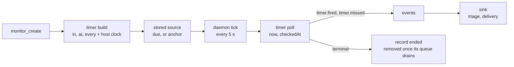
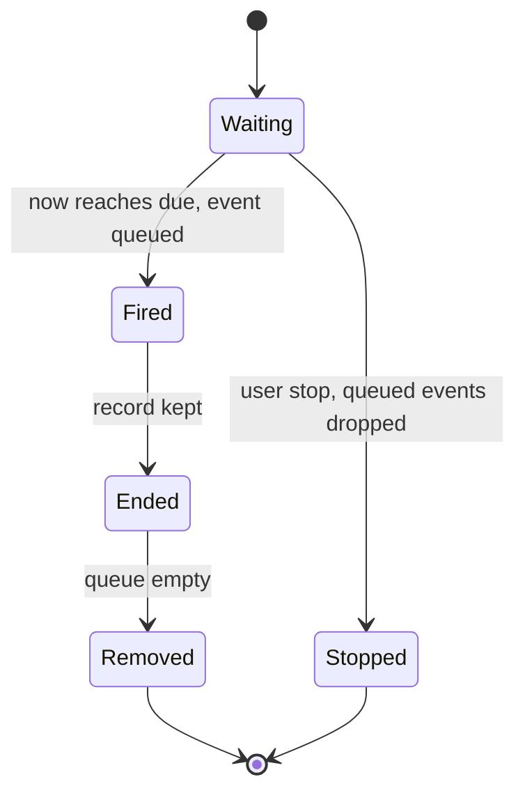

# P1b: timers

**Status: Implemented** in [0.6.0-rc.2]. The timer runs in-process on the
daemon. The closed [#31] records the migration scope.

## You can

Set a one-shot or interval timer as a monitor and receive its firing as an
event.

```sh
sourcefed monitor create --name deploy --source-type timer \
  --job "check the deploy" --in 20m --timezone Asia/Kolkata
```

Twenty minutes later the session receives a `timer.fired` event whose summary
reads:

```text
Timer check the deploy fired at 2026-11-19T15:20:00+05:30
```

See the [timer README](../../providers/timer/README.md) for inputs, examples
and firing behavior.

## The path of a timer

`monitor_create` resolves the timer against the host's clock once and stores the
result. Each daemon tick polls it with the current time, and what it returns goes
through the same sink as every other source.



A one-shot moves through these states. A user's stop at any point before the
queue drains drops what is still queued.



## Recording

The recording installs the released 0.6.0-rc.2 tarball in a disposable `node:24`
container with no host mounts and no published ports. `sha256sum -c SHA256SUMS`
passes for the tarball, whose digest is
`911ce14836357c16d4348b101efc4f68646fcf811440bec77b610358ec9872fe`. The daemon
answers 401 without a bearer token and 200 with one, listing all eight source
types. OpenCode 2.3.0 runs on the Mac with `--standalone`, the saved Go
credential and a scratch config that loads only the rc's plugin, on model
`opencode-go/hy4-flash-free`, a route the owner approved on 2026-11-19.

The agent creates three timers: `in: "1m"`, `every: "1m"` and one at 12:26 in
`Asia/Kolkata`, each with a job that tells it what to write to `timers.log`. The
one-shot fires at 12:23:53+05:30 and is gone after; the interval fires at
12:23:53 and 12:24:53, and the agent stops it after the second. The daemon is
SIGTERMed inside the container at 06:55:59Z, just before the 12:26 due time, and
restarted over the same state at 06:58:40Z. Exactly one `timer.fired` arrives at
12:26:00+05:30 marked `, 2m late`; the agent writes that line. Verification shows
`standupFired=1`, `standupLate=true`, `logKinds timer.fired:1` and `queued=0`,
unchanged after another poll cycle. The captions carry the real event times from
the events and the daemon log.


The three timers and their events are real; the waits between firings are cut.
One of the eight sources is shown (timer); the goldens cover the rest.

## What it builds

### 1. Terminal events are delivered (core)

A poll or webhook that returns `terminal: true` ends its monitor: the record is
kept, not polled, until the events it queued last are delivered. This covers
every source with a terminal event, GitHub's merged and closed among them, so a
monitor that ends while no session listens still delivers its last event.

The daemon follows three rules:

- **Delivery.** A queued event is delivered while its monitor is enabled or
  ended. A stopped or removed monitor's queued events are dropped.
- **Removal.** An ended record is removed once its target holds no queued event
  of it: after an acknowledgement or a drop, after a user's stop (which drops
  first), when the daemon hears the ending, and when the daemon starts. A
  session may take the last event before the ending is stored, so hearing the
  ending checks again. The check is not atomic with the list; a record it misses
  goes at the next acknowledgement or start.
- **Lists.** `listMonitors` leaves an ended monitor out at once; `getMonitor`
  still finds it while its record lasts. `listTargets` keeps the target of an
  ended monitor whose events wait, so a host that restarts subscribes again and
  receives them.

Files: `packages/core/src/monitors/schema.ts`,
`packages/core/src/monitors/service.ts`,
`packages/core/src/monitors/poll/monitor.ts`,
`packages/core/src/monitors/webhook/monitor.ts`, `packages/daemon/src/daemon.ts`.

```ts
const store = new InMemoryMonitorStore()

const daemon = new SourcefedDaemon({
  store,
  eventQueue: new InMemoryMonitorEventQueue(),
})

await daemon.createMonitor(target, {
  name: "pr",
  sourceType: "github",
  repo: "acme/web",
  prNumber: 42,
})

// A signed pull_request delivery for the merge, while no session listens.
await daemon.webhook(merged)

await daemon.listMonitors(target)
// { ok: true, monitors: [] }; the record has endedAt and the merge waits

const late: QueuedMonitorEvent[] = []
daemon.subscribe(target, (events) => late.push(...events))
// late holds the merge event

await daemon.acknowledgeEvents(target, late.map((queued) => queued.id))

const { monitors } = await store.load()
// monitors is []: the record is gone
```

**Structure.** A record carries `endedAt` once its source says it is finished.
A record stored without it loads unchanged.

```ts
export const MonitorRecordSchema = v.object({
  id: v.string(),
  …
  enabled: v.boolean(),
  …
  endedAt: v.optional(v.string()),
})

export type MonitorRecord = v.InferOutput<typeof MonitorRecordSchema>
```

`end` sets `enabled` to false and stamps `endedAt` in one store write, then calls
each `onEnd` listener with the stored record. A listener that throws is logged
and does not fail the ending, nor the poll or webhook that ended it. `end` of an
unknown id does nothing. `onEnd` returns the function that unsubscribes.
`start` refuses an ended monitor with `monitor <id> has ended`, and `create`
reuses only an enabled monitor, so an ended one never blocks a new one. A
terminal result in core's `PollMonitor` or `WebhookMonitor` calls `end`.

```ts
export type MonitorEndListener = (monitor: MonitorRecord) => void | Promise<void>

export class MonitorService {
  end(id: string): Promise<void>;
  onEnd(listener: MonitorEndListener): () => void;
  start(id: string): Promise<MonitorRecord | { error: string }>;
}
```

**Verified by**

- `packages/daemon/src/terminal-delivery.test.ts`: a merged pull request's
  event reaches a session that subscribes after it; the ended monitor leaves
  the lists at once and the store once its event is acknowledged; a user's
  stop drops its queued event; a restarted host still finds its target; an
  ending heard after its last event was acknowledged removes the record at
  once; stopping it with nothing queued leaves no record; its event waiting
  across a restart arrives once, then the record goes; starting removes ended
  monitors with nothing queued and keeps those with events waiting.
- `packages/core/src/monitors/transport.test.ts`: a terminal poll ends its
  monitor, which is not polled again; an ended monitor cannot be started and
  does not block a new one.
- `packages/core/src/monitors/service.test.ts`: end listeners hear an ending
  after it is stored, and a failing one does not fail it.
- `packages/core/src/storage/json.test.ts`: the JSON store keeps `endedAt`
  across instances and loads a record stored without it.

### 2. `build` receives the host clock (SDK)

A source resolves relative input against the host clock when its monitor is
created. The [SDK README](../../packages/sdk/README.md) describes the interface.

Files: `packages/sdk/src/source.ts`, `packages/sdk/README.md`.

**Structure.** `defineSource` binds the host clock into `build`, so core's
`Monitor.build` takes one argument. `SourceHost` is in [P0](p0-sdk.md).

```ts
export type SourceDefinition<T extends MonitorSource> = {
  …
  readonly build: (input: MonitorCreateInput, now: () => Date) => SourceInput
  …
}
```

**Verified by** "builds with the host's clock" in
`packages/sdk/src/source.test.ts` and the golden replays.

### 3. The timer source (`providers/timer`)

The [timer README](../../providers/timer/README.md) describes its inputs,
firing behavior and examples. The daemon registry connects the source to the
monitor runtime.

Files: `providers/timer/src/`, `packages/daemon/src/registry.ts` and the
CLI and host tool adapters.

**Structure.** `buildTimer` resolves create input once against the creation
instant; `pollTimer` returns the cursor, events and whether the monitor ends,
with a firing on time when within `ON_TIME_MS`.

```ts
type Refusal = { error: string }

type TimerPoll = { cursor: TimerCursor; events: SourceEvent[]; terminal: boolean }

export function buildTimer(
  raw: TimerCreateInput,
  now: Date,
): TimerSource | Refusal;

export const ON_TIME_MS = 2 * 60_000

export function pollTimer(
  source: TimerSource,
  cursorRaw: unknown,
  now: Date,
): TimerPoll;
```

**Verified by**

- Unit tests in `providers/timer/src` with an injected `now`:
  `durations.test.ts` (units, order, bounds, refusals), `at.test.ts` (local,
  `Z` and offset times, the gap, calendar refusals), `zoned.test.ts`
  (America/New_York's gap on 2026-03-08 and repeat on 2026-11-01, Sydney's,
  Asia/Kolkata's offset, calendar and elapsed steps, time zone refusals),
  `build.test.ts` (each input and refusal, a past `at`, the 366-day bound, the
  system timezone), `firings.test.ts` (the window's bounds, a day across the
  spring-forward change, a week, a year's gap at one minute), and
  `poll.test.ts` (on time, late, a past `at`, five missed periods, a corrupt
  cursor, a stored `every` that does not parse, the same id on time and late,
  and a sleep that keeps the phase).
- `providers/timer/src/monitor.test.ts`: `build` reads the host's clock, and
  runtimes over one in-memory store with the source's host clock prove the
  restart. A one-shot due while stopped fires once, late, and ends; a third
  start fires nothing. An interval stopped across two periods sends one
  `timer.missed`, then fires on its phase.
- "a timer's identity" in `packages/daemon/src/daemon.test.ts`: the same `in`
  an hour apart is two monitors, and at the same time reuses the monitor.
- `packages/daemon/src/monitors-audit.test.ts`: a stored one-shot and interval
  keep their keys, and their cursors parse.
- `scripts/integration/provider-timer.test.mjs`, run by CI's "Timer
  integration" job across two processes. Daemon A
  (`scripts/integration/timer-daemon.mjs`, whose poll loop never comes round)
  creates a one-shot three minutes past due and stops. Daemon B, the packed CLI
  daemon over the same state folder, fires it once, late, for the time it was
  due; one more poll cycle brings nothing, the saved queue holds that one
  event, and once it is acknowledged the monitor leaves the list.

## End to end

- The tests above on the final tree, with [#29]'s replay fixtures and the seven
  goldens unchanged, and CI's "Timer integration" job.
- The [0.6.0-rc.2] release candidate, installed from its released tarball. The
  tarball is checked against the release's `SHA256SUMS` and this digest:

  ```text
  911ce14836357c16d4348b101efc4f68646fcf811440bec77b610358ec9872fe  fdcn-sourcefed-0.6.0-rc.2.tgz
  ```

- The [recording](#recording). OpenCode runs on the Mac with `--standalone`, the
  saved Go credential and a scratch config that loads only the rc's plugin, a
  route the owner approved on 2026-11-19. The daemon runs from the rc tarball in
  a disposable container with no host mounts and no published ports. The agent
  creates three timers: `in: "1m"`, `every: "1m"` and one at 12:26 Asia/Kolkata.
  The one-shot fires and its monitor ends; the interval fires twice. The daemon
  stops across the due time and restarts, and that timer fires once, late. The
  monitor log shows each event with its real time. Waits are cut.

## Known bound

Never twice holds across restarts and sleep. A crash in the instant between the
queue write and the store write, after the session already acknowledged the
event, can repeat it once: closing that needs one transaction across two files,
which this slice does not build.

An ended monitor whose session never subscribes again keeps its record and its
queued events: nothing delivers them, and the daemon removes them only when they
are taken, dropped, or the monitor is stopped or removed by hand. This growth is
accepted. The queue keeps any silent session's events the same way, ended or
not, and both are bounded by the monitors a person created.

[#29]: https://github.com/wrkhse/sourcefed/pull/29
[#31]: https://github.com/wrkhse/sourcefed/issues/31
[0.6.0-rc.2]: https://github.com/wrkhse/sourcefed/releases/tag/v0.6.0-rc.2
