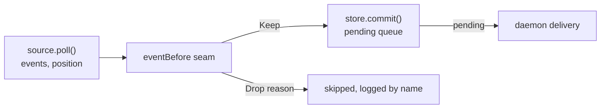

# P2: eventBefore filter

**Status: Planned.** A bounded verdict seam drops bot-authored events before
they reach the store. The [source and plugin API RFC][rfc] tracks the work.

## You can

Drop an event authored by a bot before it is stored, while an event authored
by a person passes through unchanged. One poll reports both; only one is
committed.

```text
event author=deploy-bot  ->  Drop { reason: "bot author" }, not stored
event author=steven      ->  Keep, stored and delivered
```

## The path of an event

`PollEngine` reads a source, then commits its outcome. `eventBefore` runs in
between: it asks for one verdict per event before `store.commit()` writes the
position, seen IDs and pending queue.



## Parts

### 1. Event author

Every event carries an optional author, so a filter can name who wrote it.
The field is `author: Option<String>` with a serde default: an event stored
without the key loads as `None`, and older state files keep their meaning. A
source sets the author when it builds the event.

Files: `rust/crates/core/src/event.rs`.

```rust
let event = Event::new(id, kind, subject, summary, at)?
    .with_author(Some("deploy-bot".into()));

assert_eq!(event.author(), Some("deploy-bot"));
```

**Verified by** a wire test that an event carrying `author` round-trips and
one stored without the key deserializes to `None`.

### 2. EventBefore trait

A trait supplies one `BeforeVerdict` per event: `Keep` or `Drop { reason }`.
The engine bounds each verdict with `EVENT_BEFORE_TIMEOUT`; the default hook,
`AllowAll`, keeps every event. A hook error or a timeout keeps the event and
logs under `HOOK_ERROR_REASON` or `HOOK_TIMEOUT_REASON`, so a filter cannot
lose an event by failing. One trait serves every implementation: an
in-process fake answers inline in tests, and a framed stall client talks to a
plugin process later without a trait change.

Files: `rust/crates/core/src/event_before.rs`, `rust/crates/core/src/poll.rs`,
`rust/crates/core/src/lib.rs`.

```rust
impl EventBefore for DropBots {
    fn verdict(&self, event: &Event) -> Result<BeforeVerdict, String> {
        match event.author() {
            Some(name) if name.starts_with("bot-") => Ok(BeforeVerdict::Drop {
                reason: "bot author".into(),
            }),
            _ => Ok(BeforeVerdict::Keep),
        }
    }
}

let engine = PollEngine::new(config, source, store, clock)?
    .with_event_before(Arc::new(DropBots), EVENT_BEFORE_TIMEOUT);
```

**Verified by** engine tests with the in-process fake: a dropped event never
reaches the store, a kept event does, and a hook error or a timeout keeps the
event and logs `HOOK_ERROR_REASON` or `HOOK_TIMEOUT_REASON`. A stalling fake
proves the wait stays inside `EVENT_BEFORE_TIMEOUT`.

### 3. Plugin data

`plugin.luau` and `types/sourcefed.d.luau` ship as data files. sourcefed has
no Luau runtime: it never loads or executes them. The declaration fixes the
`BeforeVerdict` wire names for the framed client that implements the trait
later; the Rust `BeforeVerdict` and the Luau declaration stay in step.

Files: `plugins/quiet-bots/plugin.luau`, `types/sourcefed.d.luau`.

```luau
function plugin.eventBefore(event: Event): BeforeVerdict
  local author = event.author

  if author ~= nil and BOT_AUTHORS[author] then
    return { kind = "drop", reason = "bot author" }
  end

  return { kind = "keep" }
end
```

**Verified by** a data test that reads both files and checks their verdict
names match `BeforeVerdict::Keep` and `BeforeVerdict::Drop`, and a Cargo check
that the core crate declares no Luau runtime dependency.

## End to end

- The `rust` job runs `cargo fmt --check`, `cargo deny`, clippy with warnings
  denied, nextest, doc tests and the docs build on the final tree.
- Mutation testing over the changed Rust files catches every viable mutant.
- Unit tests drive the seam with the in-process fake: one bot-authored event
  is dropped and one normal event is committed through the real poll engine.
- The built `sourcefed-core` `follow` command, run against a source that
  reports both events, prints only the kept event as NDJSON; the dropped
  author appears in the log with its reason name.

[rfc]: https://github.com/wrkhse/sourcefed/issues/56
