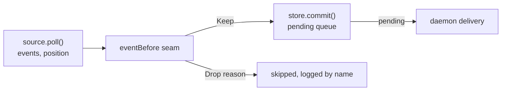

# P2: eventBefore filter

**Status: In progress.** A bounded verdict seam drops bot-authored events before
they reach the store. Unit tests cover the seam; no production caller uses
`with_event_before` yet, and the end-to-end check waits for the framed client.
The [source and plugin API RFC][rfc] tracks the work.

## You can

Drop an event authored by a bot before it is stored, while an event authored
by a person passes through unchanged. One poll reports both; only one is
committed.

```text
event author=deploy-bot  ->  Drop { reason: "bot author" }, not stored
event author=steven      ->  Keep, stored and delivered
```

## The path of an event

`PollEngine` reads a source, then commits its outcome. `eventBefore` runs in
between: it asks for one verdict per event before `store.commit()` writes the
position, seen IDs and pending queue.



## Parts

### 1. Event author

Every event carries an optional author, so a filter can name who wrote it.
The field is `author: Option<String>` with a serde default: an event stored
without the key loads as `None`, and older state files keep their meaning. A
source sets the author when it builds the event. GitHub and Slack are
TypeScript providers, so their author population is left for the framed slice.

Files: `rust/crates/core/src/event.rs`.

```rust
let event = Event::new(id, kind, subject, summary, at)?
    .with_author(Some("deploy-bot".into()));

assert_eq!(event.author(), Some("deploy-bot"));
```

**Verified by** `author_defaults_to_none_and_round_trips_when_present`: an event
stored without `author` loads as `None`, and a present author round-trips with
its exact wire shape.

### 2. EventBefore trait

A trait supplies one `BeforeVerdict` per event: `Keep` or `Drop { reason }`.
The engine bounds each verdict with `EVENT_BEFORE_TIMEOUT`; the default hook,
`AllowAll`, keeps every event. A hook error or a timeout keeps the event and
logs under `HOOK_ERROR_REASON` or `HOOK_TIMEOUT_REASON`, so a filter cannot
lose an event by failing. The hook runs on its own thread, so one that panics
disconnects the channel and keeps the event under `HOOK_ERROR_REASON`. One
trait serves every implementation: an in-process fake answers inline in tests
and a framed client talks to a plugin process without a trait change.

Files: `rust/crates/core/src/event_before.rs`, `rust/crates/core/src/poll.rs`,
`rust/crates/core/src/lib.rs`.

```rust
impl EventBefore for DropBots {
    fn verdict(&self, event: &Event) -> Result<BeforeVerdict, String> {
        match event.author() {
            Some(name) if name.starts_with("bot-") => Ok(BeforeVerdict::Drop {
                reason: "bot author".into(),
            }),
            _ => Ok(BeforeVerdict::Keep),
        }
    }
}

let engine = PollEngine::new(config, source, store, clock)?
    .with_event_before(Arc::new(DropBots), EVENT_BEFORE_TIMEOUT);
```

**Verified by** unit tests on `decide_before` for keep, drop, error and timeout,
and poll engine tests that check the seen ledger and pending queue: a dropped
event is neither seen nor pending, while a kept event survives a store reopen.
A blocking hook keeps the event at a shortened deadline.

### 3. Framed plugin client

The client that implements `EventBefore` over a framed protocol belongs to the
framed proof against tack's SDK. It owns the `BeforeVerdict` wire names and the
plugin entry point; no files for it live here.

## End to end

- The `rust` job runs `cargo fmt --check`, `cargo deny`, clippy with warnings
  denied, nextest, doc tests and the docs build on the final tree.
- Mutation testing over the changed Rust files catches every viable mutant.
- Unit tests drive the seam with in-process hooks: a bot-authored event is
  dropped and a normal event is committed through the real poll engine.
- The end-to-end check waits for the framed client, which lands with the framed
  proof.

[rfc]: https://github.com/wrkhse/sourcefed/issues/56
