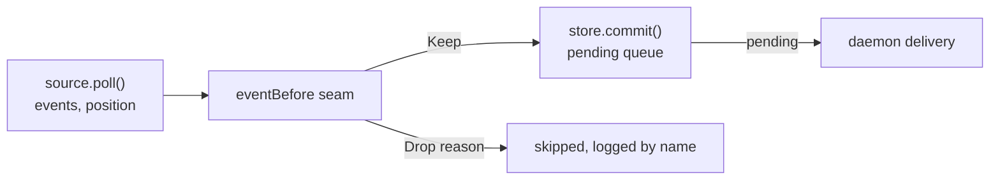

# P2: eventBefore filter

**Status: In progress.** A bounded verdict seam drops bot-authored events before
they reach the store. Unit tests cover the seam; no production caller uses
`with_event_before` yet, and the end-to-end check waits for the framed client.
The [source and plugin API RFC][rfc] tracks the work.

## You can

Drop an event authored by a bot before it is stored, while an event authored
by a person passes through unchanged. One poll reports both; only one is
committed.

```text
event author=deploy-bot  ->  Drop { reason: "bot author" }, not stored
event author=steven      ->  Keep, stored and delivered
```

## The path of an event

`PollEngine` reads a source, then commits its outcome. `eventBefore` runs in
between: it asks for one verdict per event before `store.commit()` writes the
position, seen IDs and pending queue.



## Parts

### 1. Event author

Every event carries an optional author, so a filter can name who wrote it.
The field is `author: Option<String>` with a serde default: an event stored
without the key loads as `None`, and older state files keep their meaning. A
source sets the author when it builds the event. GitHub and Slack are
TypeScript providers today; #56 ports sources to Luau tables in barn stalls,
so author population follows the github-issues and Slack ports.

Files: `rust/crates/core/src/event.rs`.

```rust
let event = Event::new(id, kind, subject, summary, at)?
    .with_author(Some("deploy-bot".into()))?;

assert_eq!(event.author(), Some("deploy-bot"));
```

**Verified by** `author_defaults_to_none_and_round_trips_when_present`: an event
stored without `author` loads as `None`, and a present author round-trips with
its exact wire shape.

### 2. EventBefore trait

A trait supplies one `BeforeVerdict` per event: `Keep` or `Drop { reason }`.
The engine bounds the whole commit's verdicts with `EVENT_BEFORE_TIMEOUT`,
passing the remaining budget to each hook. Once that budget is zero it
early-returns `Keep` under `HOOK_TIMEOUT_REASON` without claiming the in-flight
slot or spawning a thread; a verdict already in flight gets `Keep` under
`HOOK_BUSY_REASON`. The default hook, `AllowAll`, keeps every event. A hook
runs on its own thread, so one that never answers is kept under
`HOOK_TIMEOUT_REASON` at the deadline, and one that panics disconnects the
channel and is kept under `HOOK_PANIC_REASON`. A hook error keeps the event
under `HOOK_ERROR_REASON`, so a filter cannot lose an event by failing.

One trait serves every implementation: tests use an in-process fake hook;
production runs through tack's daemon socket, where sourcefed's own small
framed client against the git-pinned `tack_protocol` crate implements the same
trait. There is no plugin process and no tack-client crate.

Files: `rust/crates/core/src/event_before.rs`, `rust/crates/core/src/poll.rs`,
`rust/crates/core/src/lib.rs`.

```rust
impl EventBefore for DropBots {
    fn verdict(
        &self,
        event: &Event,
        budget: Duration,
    ) -> Result<BeforeVerdict, String> {
        match event.author() {
            Some(name) if name.starts_with("bot-") => Ok(BeforeVerdict::Drop {
                reason: "bot author".into(),
            }),
            _ => Ok(BeforeVerdict::Keep),
        }
    }
}

let engine = PollEngine::new(config, source, store, clock)?
    .with_event_before(Arc::new(DropBots), EVENT_BEFORE_TIMEOUT);
```

**Verified by** `decide_before` tests for keep, drop, error, timeout, busy,
zero-budget, panic and no-spawn; engine tests that a bot after a human is still
dropped, that a stop mid-batch replays the whole outcome, and that a timeout is
clamped to `EVENT_BEFORE_TIMEOUT`; store tests that skipped IDs are seen but
not pending in both `Store` and the sim `MemoryStore`.

### 3. Framed plugin client

The client implements `EventBefore` over tack's daemon socket using the
git-pinned `tack_protocol` crate. sourcefed writes the small framed client
itself, no tack-client crate and no plugin entry point here; no files for it
live in this slice.

## Decided

| Choice             | Decision                                               | By    | When       |
| ------------------ | ------------------------------------------------------ | ----- | ---------- |
| eventBefore client | git-pin `tack_protocol` by rev, the way tack pins barn | owner | 2026-11-28 |

The dependency is the `tack_protocol` crate (`crates/protocol` in wrkhse/tack),
git-pinned by rev the same way tack pins barn. sourcefed writes its own small
framed client against tack's daemon socket in a later PR; there is no
tack-client crate, and sourcefed never launches barn. The in-process seam
lands first; the framed client implements the same `EventBefore` trait once
tack's daemon hook and barn's engine are in.

## End to end

- The `rust` job runs `cargo fmt --check`, `cargo deny`, clippy with warnings
  denied, nextest, doc tests and the docs build on the final tree.
- Mutation testing over the changed Rust files catches every viable mutant.
- Unit tests drive the seam with in-process hooks: a bot-authored event is
  dropped and a normal event is committed through the real poll engine.
- The end-to-end check waits for the framed client, which lands with the framed
  proof.

[rfc]: https://github.com/wrkhse/sourcefed/issues/56
