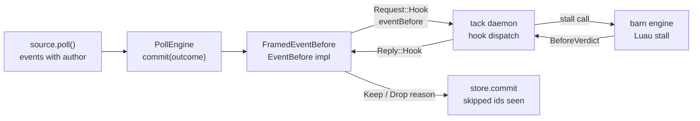

# P3: framed eventBefore client

**Status: Planned.** A sourcefed client asks tack's daemon to run an
`eventBefore` hook over a framed socket before `store.commit()`. The slice
waits on tack's daemon hook registration and barn's engine (barn#72, barn#74);
no code lands until the plan is approved. The [RFC][rfc] tracks the work.

## You can

Drop bot-authored events in a running Rust engine using P2's `EventBefore`
trait. One poll carries `author=deploy-bot` and `author=steven`: the hook
returns `Drop { reason: "bot author" }` and `Keep`, respectively, and only
steven enters pending.

## The path of a verdict



## Parts

### 1. Git-pinned protocol dependency

sourcefed depends on `tack_protocol` from `crates/protocol` in wrkhse/tack,
git-pinned by rev as tack pins barn. There is no tack-client crate, and
sourcefed never launches barn.

Files: `rust/crates/core/Cargo.toml`, `rust/Cargo.lock`.

```toml
tack_protocol = { git = "https://github.com/wrkhse/tack", rev = "<pinned rev>" }
```

**Verified by** the CI dependency check and codec tests decoding
`tack_protocol` `Request::Hook` and `Reply::Hook`.

### 2. Framed client

`FramedEventBefore::new(socket_path, hook_name)` implements `EventBefore`,
maps an `Event` to the hook payload, uses the trait budget as its deadline,
and keeps P2's fail-open reasons.

Files: `rust/crates/core/src/event_before_framed.rs` and
`rust/crates/core/src/lib.rs`.

```rust
let hook = FramedEventBefore::new(socket_path, hook_name);

let engine = PollEngine::new(config, source, store, clock)?
    .with_event_before(Arc::new(hook), EVENT_BEFORE_TIMEOUT);
```

**Verified by** framed fake codec, deadline and error tests, and a real-socket
contract test.

### 3. Daemon hook and barn stall

tack's daemon registers the `eventBefore` hook and barn's engine invokes the
stall. sourcefed calls it over the socket.

Files: none in this repo; tack and barn slices own this work.

The hook name is a placeholder until the question below is answered.

**Verified by** the end-to-end check with a real daemon and stall.

## Questions for tack-slice-1

Which hook path does tack's daemon expose for `eventBefore`? The client needs
the socket path or its derivation from daemon config, the exact
`Request::Hook.hook` identifier, and the reply shape carrying a
`BeforeVerdict`. The wire type has a free-form `hook: String` and handles
only `toolBefore` and `permissionAsked`; no `eventBefore` name exists.
The hook name stays a placeholder until this is answered.

## Follow-up

The [RFC][rfc] says:

> TypeScript remains only where a JS-hosted harness or an npm import requires it.

> Each port is a roadmap line, planned against tack's SDK (tack#23) and the
> barn-as-program decision; none is an open issue now.

The first end-to-end proof waits for the github-issues port, now planned as [P4][p4] after this slice.

## Decided

The [P2 Decided table][p2] records the git pin. sourcefed writes its own
client against tack's daemon socket.

## End to end

Approve this plan; wait for tack's daemon hook and barn's engine; pin
`tack_protocol` by rev; implement the codec and client; and run Rust gates and
mutation checks. With the github-issues port, run a real daemon socket with a
barn stall, poll one bot-authored and one human-authored event, and assert only
the human event reaches pending.

[p2]: p2-event-before.md
[p4]: p4-github-issues-source.md
[rfc]: https://github.com/wrkhse/sourcefed/issues/56
