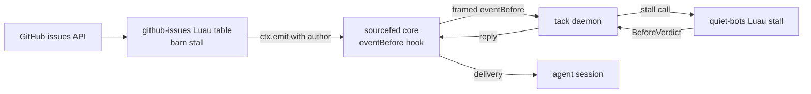

# P4: github-issues Luau source

**Status: Planned.** The github-issues source is a plain Luau table in a
barn stall, filling `author` on each emitted issue event so quiet-bots can drop
`[bot]` authors. It follows [P3][p3] and waits on tack#23's later PRs and
barn#72/#74; no code lands until the plan is approved. The [RFC][rfc] tracks
the work.
The golden transcripts and real-socket proof wait on tack's hook.

## You can

Watch a GitHub issue collection and receive its issue events with `author`
filled. One `[bot]` issue is dropped by quiet-bots before reaching an agent
session, while a human issue is delivered.

## The path of an issue



## Parts

### 1. Luau source table

The github-issues source is a plain Luau table in a barn stall. It declares a
poll trigger and an `http` need that the host grants, and emits issue events
carrying `author`. The cursor bound is an open question in [P3][p3].

Files: `sources/github-issues/plugin.luau`, its recorded fixtures, and the
golden transcript tests under `sources/github-issues/fixtures/`.

```luau
ctx.emit({
    kind = "issueLabeled",
    author = issue.user.login,
    …
})
```

**Verified by** golden transcript tests over recorded GitHub issue payloads.

### 2. Dependencies

The table uses hook tables, grants and the contract version from tack#23's
later PRs and runs in a barn stall from barn#72/#74. tack#20 owns the stall
loader; barn owns the startup and bounded-call tests. sourcefed never launches
barn and passes no names to the loader.

Files: none in this repo.

**Verified by** tack#20 and barn's own tests.

### 3. Author through eventBefore

Each issue carries `author`, so [P3][p3]'s framed client sends it to the tack
daemon hook (the [P2][p2] `eventBefore` seam) and quiet-bots drops names
ending in `[bot]`.

Files: the source table and the framed client's local socket tests in
`rust/crates/core/src/event_before_framed.rs`.

Usage: the quiet-bots `eventBefore` hook from #56.

```luau
eventBefore = function(event)
    if string.find(event.author or "", "%[bot%]") then
        return { drop = true }
    end
end,
```

tack's wire `drop` carries no reason, so sourcefed maps it to
`Drop { reason = "plugin-drop:quiet-bots" }`.

**Verified by** the joint tack#23 PR4 proof over a real socket with a barn
stall.

## Decided

Open questions for this slice live in [P3][p3]: the emit shape and the cursor
bound.

| Choice     | Decision                                     |
| ---------- | -------------------------------------------- |
| Port order | [#56][rfc] places this port at P4, after P3. |

## End to end

The single joint proof is owned with tack#23 PR4 and hosted in tack's CI.
sourcefed supplies the source table and client. A bot issue is dropped, a
non-bot issue is annotated with its fields, and assertion runs in that one job.

[p2]: p2-event-before.md
[p3]: p3-framed-client.md
[rfc]: https://github.com/wrkhse/sourcefed/issues/56
