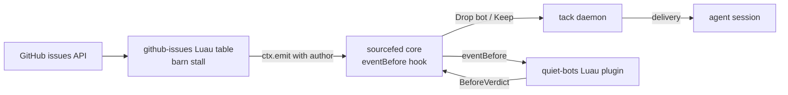

# P4: github-issues Luau source

**Status: Planned.** The github-issues source becomes a plain Luau table in a
barn stall, filling `author` on each emitted issue event so quiet-bots can drop
`[bot]` authors. It follows [P3][p3] and waits on tack#23's later PRs and
barn#72/#74; no code lands until the plan is approved. The [RFC][rfc] tracks
the work.

## You can

Watch a GitHub issue collection and receive its issue events with `author`
filled. One `[bot]` issue is dropped by quiet-bots before reaching an agent
session, while a human issue is delivered.

## The path of an issue



## Parts

### 1. Luau source table

The github-issues source is declared as a plain Luau table in a barn stall. It
registers a poll trigger and an `http` capability, keeps a bounded cursor, and
emits issue events carrying `author`.

Files it will create: `sources/github-issues/plugin.luau` and its recorded
fixtures.

```luau
ctx.emit({
    kind = "issueLabeled",
    author = issue.user.login,
    ...
})
```

**Verified by** golden transcript tests over recorded GitHub issue payloads.

### 2. tack SDK and barn dependencies

The table uses hook tables, grants and the contract version from tack#23's
later PRs, and runs in a barn stall from barn#72/#74; sourcefed never launches
barn.

Files it will create: the source's SDK type declarations and the loader entry
owned by tack#20; no config file exists in this repo yet.

Usage: the source registers as `github-issues` and quiet-bots registers as
`quiet-bots`; both names are passed to the stall loader at startup.

**Verified by** a stall startup test with a bounded call deadline and no
default capabilities.

### 3. Author through eventBefore

Each issue carries `author`, so [P3][p3]'s framed client sends it to the tack
daemon hook (the [P2][p2] `eventBefore` seam) and quiet-bots drops names
ending in `[bot]`.

Files: the source table and the P3 contract test.

Usage: the quiet-bots `eventBefore` hook from #56.

```luau
eventBefore = function(event)
    if string.find(event.author or "", "%[bot%]") then
        return { drop = true }
    end
end,
```

**Verified by** a real socket contract test with a barn stall asserting the
`[bot]` issue is dropped and the human issue is delivered.

## Decided

[#56][rfc] moves this port from Later work to P4, right after [P3][p3]. The
[RFC][rfc] is the canonical record.

## End to end

Approve this plan; land P3's framed client and tack#23/barn#72/#74; install the
source table and quiet-bots; poll one `[bot]` and one human issue; run Rust
gates, provider transcript tests and a real daemon socket; assert only the
human issue reaches the agent session.

[p2]: p2-event-before.md
[p3]: p3-framed-client.md
[rfc]: https://github.com/wrkhse/sourcefed/issues/56
