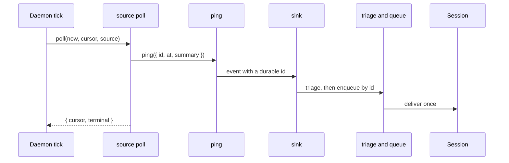
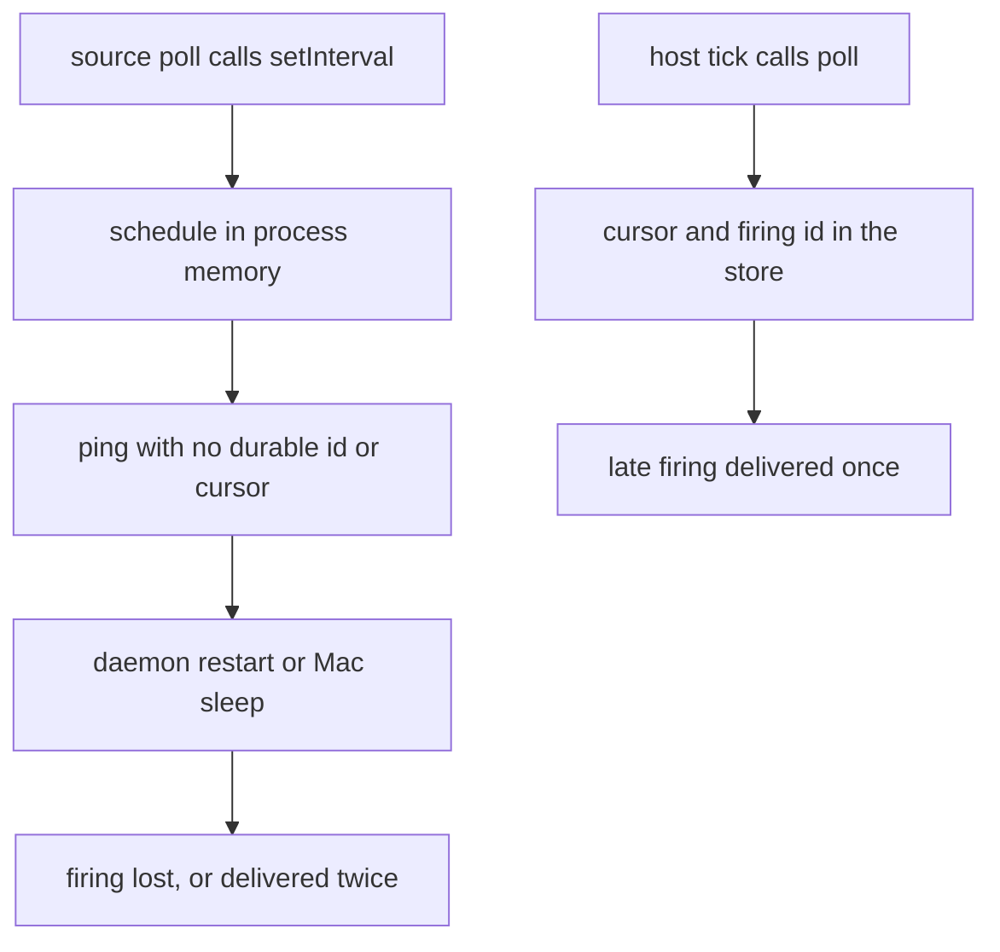

# P6: the source authoring API

**Status: Planned.** It follows the ports in [P0][p0] and [P1b][p1b] and waits
on the owner answers in [Open owner questions](#open-owner-questions). Part of
the plan in [#31]; the slices are listed in the [index](README.md).

## You can

Author a source in one definition: a name, an input schema, an output schema
and a poll. The host calls `poll` on its clock; the source emits the events
that are due and returns the cursor. This is the owner's target shape:

```ts
export default defineSource({
  name: "clock",
  input: z.object({ every: z.number() }).parse,
  output: z.object({}).parse,
  poll: ({ ping, input }) => {
    setInterval(() => ping(), input.every)
  },
})
```

A source-side `setInterval` does not survive a daemon restart or a Mac sleep.
It holds no durable cursor and no durable firing id, so a wake can fire the
same minute twice. A recorded clock cannot replay it: the recorder drives one
poll with a fixed `now`, while a timer started in the source follows the host's
wall clock. Host-pull gives one firing, late when needed, never twice: the
daemon owns the clock and the cursor.

The closest safe shape keeps `name`, `input`, `output` and `ping` and moves the
clock into the daemon:

```ts
export default defineSource({
  name: "clock",
  input: z.object({ every: z.number().min(1) }),
  output: z.object({ at: z.string() }),
  poll: ({ input, cursor, now, ping }) => {
    const due = nextDue(input.every, cursor, now())
    if (due) {
      ping({ id: `clock:${due}`, at: due, summary: `Clock fired at ${due}` })
    }
    return { cursor: { checkedAt: now().toISOString() }, terminal: false }
  },
})
```

`ping` calls the same sink the poll and webhook paths use. Triage, queue dedupe,
acknowledgement and delivery stay host-owned; a source never enqueues an event
itself. The id a source gives `ping` is its firing key, and the host prefixes
the monitor id, so an on-time firing and its late replay are the same event.
A one-shot also returns `terminal: true`. A source needing an early wake keeps
the existing `wake` hook.

## The two paths

On the host-pull path the daemon ticks, the source decides what is due, and the
host records what it emitted:



On the owner's path the schedule lives in process memory, so a restart or a
sleep drops it and a second daemon can fire it again:



## What it builds

### The definition

A source is a name, an input schema, an output schema and a poll. The input
and output values are schema objects, not parsed functions: one value supplies
validation, TypeScript types and JSON Schema. Authors never write a generic;
the types come from the schema object. `webhook`, `wake`, `mergeCursor`,
`cursor` and `build` remain optional members, so no provider loses a
capability during the port. `build` is derived from the input schema for every
source whose create input needs no clock.

Files: `packages/sdk/src/source.ts`, `packages/sdk/src/index.ts`.

```ts
const clock = {
  name: "clock",
  input: z.object({ every: z.number().min(1) }),
  output: z.object({ at: z.string() }),
  poll: ({ input, cursor, now, ping }) => pollClock(input, cursor, now, ping),
}

export const ClockMonitor = defineSource(clock, { http, mcp, now })
```

**Verified by** `packages/sdk/src/source.test.ts`: a toy source asserts
deterministic ping ids, that `terminal` ends the record, and that a restart
or a sleep replays one late firing.

### Lowering to a core Monitor

`defineSource` still returns the core `Monitor` the daemon's registry holds.
`name` becomes the source type and the default `label`, `detail` and
`describe`: the label comes from the source's identity fields, the detail is a
short suffix, and the describe reads `Name …`. A provider whose monitor text
differs keeps an optional display function; `icon` stays one optional string.
`output` narrows the payload a `ping` may set; the host assembles the
`MonitorEvent` with core's `kind`, `id`, `at`, `summary` and `subject` fields.

Files: `packages/sdk/src/source.ts`, `packages/daemon/src/registry.ts`.

```ts
const jiraMonitor = defineSource({
  name: "jira",
  input: v.object({ issueKey: v.pipe(v.string(), v.minLength(1)) }),
  output: v.object({ key: v.string() }),
  poll: async ({ source, cursor, http, ping }) =>
    pollJira(http, source, cursor, ping),
})
```

**Verified by** `packages/sdk/src/source.test.ts` and
`packages/sdk/src/golden.test.ts`: `assertGolden` re-creates each definition
with `{ http, mcp, now }` and compares the build result, source, display,
schema, events, cursor and delivery.

### Standard Schema

The validation contract is [Standard Schema][ss]. `~standard` is one combined
family of two specs: `StandardSchemaV1` supplies `validate` and the type-only
`InferInput` and `InferOutput`, and `StandardJSONSchemaV1` adds
`jsonSchema.input({ target })` and `jsonSchema.output({ target })`. JSON Schema
introspection belongs to the second spec, so a schema implements both — the
`CombinedSpec` in the FAQ — for the `monitor_create` branch to be built.

| Concern | Bare `.parse` | Schema object |
| --- | --- | --- |
| Validation | Bound `this`; valibot has none | `~standard.validate` |
| JSON Schema | none | `jsonSchema.input({ target })` |
| Types | a function has none | `InferInput`, `InferOutput` |

Zod 4.2+ implements the combined spec natively and has `z.toJSONSchema`.
Valibot 1.4.2 supplies `validate` and types, and needs
`toStandardJsonSchema` from `@valibot/to-json-schema@1.7.1` (peer `^1.4.0`);
1.8.0 requires valibot `^1.5.0`. Zod 4.6.7 and valibot 1.5.0 are current; the
project pins valibot 1.4.2. Zod needs TypeScript 5.5+, valibot 5.0.2+, and
neither sets a Node engine bound. An author can still write `v.parse` or
`v.parser` in their own code, but a definition takes the schema object.

Files: `packages/sdk/src/schema.ts`, `packages/sdk/package.json`.

```ts
import { toStandardJsonSchema } from "@valibot/to-json-schema"
import * as v from "valibot"

const clockInput = {
  name: "clock",
  input: toStandardJsonSchema(v.object({ every: v.number() })),
}
```

`~standard.validate` may return a Promise. `defineSource` refuses an async
validator when the definition is created, naming the source; every provider
poll stays synchronous at that boundary.

**Verified by** `packages/sdk/src/schema.test.ts` and `source.test.ts`: a zod
schema and a valibot schema produce the same JSON Schema branch, a Promise
from `validate` is refused, and a bare `.parse` argument is refused with a
message that names the schema object.

### The eight ports

Every provider defines `key`, `label`, `detail` and `describe` today, plus one
optional `icon` string. Each port keeps its exported definition and monitor
names and its key, so `SOURCE_MAP` does not change.

| Source | Display today | Host hooks | New shape |
| --- | --- | --- | --- |
| jira | 4 functions, icon | none | default display |
| jira-query | 4 functions, icon | none | default display |
| github | 4 functions, icon | `mergeCursor`, webhook | keep both |
| github-issues | 4 functions, icon | `wake`, webhook path | keep `wake` + display |
| slack | 4 functions, icon | webhook, challenge, ack | keep webhook + display |
| yab | 4 functions, icon | MCP calls | keep display + MCP |
| schedule | 4 functions, icon | interval 15 | keep interval + display |
| timer | 4 functions, icon | `build(now)`, interval 15 | keep `build` + display |

The create fields stay the same: jira's `issueKey`; jira-query's `jql` and
`includeExisting`; github's `repo` and `prNumber`; github-issues' `repo`,
`labels`, `assignee`, `author`, `query` and `includeExisting`; slack's
`threadUrl`, `channelId` and `threadTs` (with `required: []`); yab's `url`,
`space`, `match` and `exclude`; schedule's `cron`, `job` and `timezone`; and
timer's `job`, `in`, `at`, `every` and `timezone`. All fit inside
`MonitorCreateInput`'s 22 keys; `prNumber` is a number and `includeExisting` a
boolean.

Only timer reads the host clock in `build`; only yab calls `mcp`; github has
`mergeCursor`, github-issues has `wake`, and slack and github have webhooks
(`/webhooks/github` with HMAC, `/webhooks/slack` with a challenge and
`acknowledgeBeforeDelivery`). Timer has no golden fixture: its unit tests and
the `TIMER_RECORDS` audit carry its proof.

A port reads in the new shape like this:

```ts
export const TimerMonitor = defineSource({
  name: "timer",
  input: timerInput,
  output: timerOutput,
  build: (input, now) => buildTimer(input, now()),
  poll: ({ source, cursor, now, ping }) =>
    pollTimer(source, cursor, now(), ping),
})
```

The golden fixtures' `events`, `requests` and `cursorAfter` stay byte-equal.
Their `build`, `source`, display and `schema` fields are re-recorded from the
new definition. The recorder calls `monitor.build(kase.build)` and
`monitor.poll.options.run` directly; both call sites move to the new definition
once, and the replay uses `defineSource(definition, { http, mcp, now })`.

Files: `providers/*/src/monitor.ts`, `providers/*/src/fixtures/golden.ts`,
`scripts/record-golden.mjs`, `packages/sdk/src/golden.ts`.

**Verified by** each provider's `golden.test.ts` and its build and display unit
tests, `packages/daemon/src/monitors-audit.test.ts`,
`packages/daemon/src/terminal-delivery.test.ts` and
`packages/daemon/src/daemon.test.ts`.

### The `monitor_create` tool schema

`create-tool.ts` builds one `anyOf` branch per `SOURCE_MAP` entry in registry
order. Each branch is an object whose `type` property is the fixed source
name, whose other properties and required list come from the combined schema's
`jsonSchema.input`, and whose description is the schema description. The outer
object requires `name` and `source`, and every object sets
`additionalProperties: false`. `toDaemonCreateInput` flattens the branch's
source fields into `DaemonCreateInput`; that stays flat.

Files: `packages/daemon/src/create-tool.ts`,
`packages/daemon/src/create-tool.test.ts`, `packages/mcp/src/server.ts`.

```ts
{
  type: "object",
  description: "Watch a Jira issue",
  properties: {
    type: { type: "string", enum: ["jira"] },
    issueKey: { type: "string" },
  },
  required: ["type", "issueKey"],
  additionalProperties: false,
}
```

`create-tool.test.ts` pins the full tool schema byte for byte; the conversion
emits those exact shapes with no new keys and in the same registry order. The
three tool descriptions in `packages/mcp/src/server.ts`,
`adapters/opencode/tools/monitor_create.ts` and `adapters/pi/src/index.ts` keep
their text.

**Verified by** `packages/daemon/src/create-tool.test.ts` (byte equality),
`packages/mcp/src/server.test.ts`, and `client.test.ts` in CI.

### Tests and PR cuts

Six cuts, each green on its own and revertable. No code exists for this slice
yet; each cut names the tests that run before it is reviewed.

1. SDK contract, Standard Schema adapters and tool-schema conversion with a
   toy source; all eight golden fixtures unchanged.
2. jira and jira-query migrated, with their goldens.
3. github and github-issues migrated, with webhook, `wake` and
   `mergeCursor`.
4. slack and yab migrated, with the webhook challenge and MCP.
5. schedule and timer migrated, with the host clock in `build`.
6. The old `SourceDefinition` surface removed, the docs and index updated,
   the release candidate cut and recorded.

On the Mac, run only builds, `tsc`, and the pure SDK, daemon, provider and
golden suites: no process starts and no host is contacted. CI alone runs
`npm run check`, `client.test.ts`, the two-process integration tests, which
pack the CLI and start a real daemon, and the timer integration job.

Files: no new files before cut 1; each cut touches the files named above.

**Verified by** the gates in [End to end](#end-to-end) at each cut.

## End to end

- The full check in CI on the final tree, plus the pure suites and tool-schema
  byte check on the Mac: build, tests, `tsc`, every golden replay and the
  tool-schema byte check, with all eight providers' `events`, `requests` and
  `cursorAfter` unchanged.
- The CI-only `client.test.ts` and process tests, including the timer
  integration job, on the locked development host.
- A release candidate, `0.6.0-rc.3` or the next free number, installed from its
  released tarball and checked against the release's `SHA256SUMS`.
- A recording showing a real timer and a real HTTP source, both authored in
  the new shape, firing into a session, with the daemon log pane beside it.
  There is no recording yet; the candidate and recording wait for cut 6.

The page moves to Implemented only after the owner reviews the candidate and
the recording.

## Open owner questions

Each question has its recommended option first.

- **a. Push or pull.**
  - Host-pull `poll` with `ping` (Recommended): one firing, late when needed,
    never twice; the recorder can replay it.
  - Keep the `setInterval` push and have the host persist the schedule: the
    target syntax stays, but a durable scheduler and ids are still needed.

- **b. The `input` argument.**
  - A schema object implementing the combined spec (Recommended): validation,
    JSON Schema and types from one value.
  - The bare `.parse` as written: a second schema object is still needed for
    JSON Schema and types.

- **c. What `name` means.**
  - `name` is the type and the default `label`, `detail` and `describe`, with
    optional overrides (Recommended): one line for most sources.
  - A separate `type` field and four display functions: explicit, with the
    boilerplate kept.

- **d. The `output` schema.**
  - The source's event payload only (Recommended): the host fills `kind`, the
    routing fields and the defaults.
  - The full `MonitorEvent`: every field is the source's job, and the host only
    delivers.

- **e. Dependencies.**
  - Keep valibot 1.4.2 and add `@valibot/to-json-schema@1.7.1` (Recommended):
    peer `^1.4.0`, with no provider upgrade.
  - Bump valibot to 1.5+ with `@valibot/to-json-schema@1.8.0`: newer, with a
    provider-wide upgrade.

- **f. Validation engines.**
  - Both zod and valibot through the combined spec (Recommended): authors use
    the engine they already have.
  - Valibot only: one conversion path, and zod-authored schemas are refused.

- **g. Migration granularity.**
  - Provider pairs per PR, as in the six cuts (Recommended): each cut is green
    and revertable.
  - All eight in one PR: one review, and one failing golden blocks every port.

## Sources

- [Standard Schema][ss] and the [spec repository][ss-repo]: the two specs, the
  combined interface and the `.parse` FAQ.
- [Zod][zod] and [Valibot][valibot]: `parse`, `toJSONSchema` and
  `toStandardJsonSchema`.
- Local contract: `packages/sdk/src/source.ts`,
  `packages/daemon/src/create-tool.ts`, `packages/sdk/src/golden.ts` and
  `scripts/record-golden.mjs`.

[#31]: https://github.com/wrkhse/sourcefed/issues/31
[p0]: p0-sdk.md
[p1b]: p1b-timer.md
[ss]: https://standardschema.dev/
[ss-repo]: https://github.com/standard-schema/standard-schema
[zod]: https://zod.dev/
[valibot]: https://valibot.dev/
