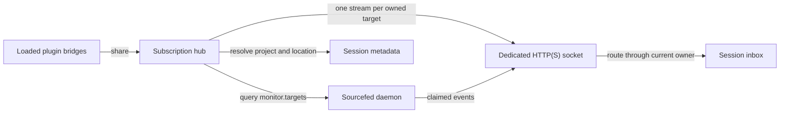

# OpenCode subscription lifecycle



## Ownership and demand

`adapters/opencode/subscriptions.ts` owns one daemon client and one 15-second
timer. `bridge.ts` stores the hub under a versioned process-global symbol so
plugin instances and re-evaluated copies of the module share it. Loaded bridges
are its owners; the last unload closes the hub, and a later plugin load creates a
fresh one.

Demand comes only from `monitor.targets`: enabled monitors and ended monitors
whose final events await delivery. A session must still exist and its `projectID`
must match a loaded owner's `ctx.location.project.id`.
Prefer an owner whose directory matches the session's current location; otherwise
use a surviving owner in the same project. Session access alone is not ownership:
OpenCode V2 session APIs can cross locations. Worktrees and session moves are
reconciled using the session's current metadata.
Delivery also resolves that metadata immediately before routing, so a move does
not have to wait for the next refresh to select the right owner.

There is one stream per demanded, owned session, not per monitor or plugin. A
surviving owner takes over routing without replacing the stream. Tools capture their
own bridge.

Startup, successful tool mutations, and the timer reconcile both additions and
removals. List/status calls do not create subscriptions. Externally created,
re-enabled, stopped or removed monitors converge within one refresh interval when
the daemon and OpenCode are reachable. Transient inventory/session lookup failures
preserve existing streams; an explicit `SessionNotFoundError` releases a deleted
session's stream. Refreshes and connection attempts are coalesced; session setup is
serial, so concurrent setup work does not grow with the number of plugin instances.

## Delivery and cleanup

Events triaged by Chauffeur at the daemon bypass the plugin's Chauffeur gate.
For other events, only an explicit `deliver: false` withholds delivery; a missing
gate, error or 3-second timeout delivers. Admitted events enter the session as
synthetic messages with event and monitor metadata. Actionable events resume an
idle agent; other events wait for the next turn.

The daemon owns event claims and acknowledgement. The HTTP client serializes
delivery with backpressure, retries failed callbacks by reconnecting, and retries
acknowledgements without invoking a successful callback again. A reconnect waits
for the in-flight delivery/acknowledgement before reopening.

Subscription cancellation covers pending setup as well as established streams.
Setup times out after 15 seconds; reconnect waits are cancellable. Closing an
established stream drains admitted delivery and acknowledgement for up to 15
seconds before destroying its streaming socket. RPC requests also have a 15-second
timeout.
Response readers, abort listeners and retry timers are released on termination.
Failed plugin registration closes the acquired bridge, including the public
plugin's guidance-hook setup path.

OpenCode admission and daemon acknowledgement are not an exactly-once transaction.
A host failure after admission but before acknowledgement can replay an event;
forced drain timeout leaves unacknowledged work for retry.

## HTTP transport isolation

Demand-based ownership prevents duplicate streams but is not a process-wide fetch
budget: 256 legitimately owned sessions can still consume Bun’s default 256
concurrent fetch slots. Returning response headers does not release a slot while
the SSE body remains open. This can starve unrelated provider requests, token
refresh and web fetches even when every subscription has a valid owner. Socket
counts alone cannot distinguish this condition from a subscription leak.

`event-transport.ts` opens SSE with `node:http` / `node:https`, using one dedicated,
non-pooled socket per subscription (`agent: false`). RPC remains short-lived
`fetch`. The event-stream state machine owns setup deadlines,
backpressure, callback/ack serialization, reconnect and draining cancellation.
The adapter bounds its Web Stream queue by bytes (64 KiB high-water mark), destroys
failed HTTP responses immediately, and destroys every response when its reader
terminates. HTTPS uses normal certificate/hostname verification and configured
CA trust; it does not disable TLS checks. The daemon URL must address its HTTP(S)
endpoint directly: unlike `fetch`, this transport does not follow redirects.

Long-lived streams use sockets outside the fetch budget without changing
`BUN_CONFIG_MAX_HTTP_REQUESTS`. Each demanded session uses one socket, and OS
resource limits apply.

## Verification

`npm run check` includes bridge lifecycle tests and live HTTP contract tests.
The HTTP regression loads 40 plugin instances for 20 enabled session targets,
checks that peak active streams remain 20 across repeated list calls, delivers and
acknowledges one event once, stops a monitor, and unloads every owner back to zero.
Other tests cover setup cancellation, failed connection/setup recovery, session
moves/deletion, refresh/unload races, callback retry and reconnect during ack.

The fetch-budget regression runs the built daemon client in a separate Bun
process with a 256-fetch limit. It opens 300 subscriptions, proves an unrelated
HTTP fetch and an event acknowledgement complete, and checks all streaming
sockets close. The test requires `bun` on PATH (or `SOURCEFED_TEST_BUN`); without
Bun it explicitly skips this runtime-specific test. The TLS rejection test
requires `openssl` and confirms a self-signed untrusted certificate is rejected.

For the installed OpenCode runtime, run:

```sh
npm run build:public
node scripts/check-opencode-subscriptions.mjs
```

This provider-free probe requires `opencode` and `openssl`. It starts only a private
foreground host with fresh HOME, all XDG directories and explicit `OPENCODE_DB`,
loads the built public daemon client in a test plugin, and creates no sessions or
monitors. It checks 300 subscriptions each over HTTP and trusted HTTPS, unrelated
fetch responsiveness, delivery/ack, setup cancellation and zero remaining sockets.
Only the child trusts its generated test CA; its files and servers are cleaned up.
The probe reports the host's OpenCode and embedded Bun versions. Without an
argument, it uses built workspace artifacts. Given an installed package directory,
it also waits for that package's plugin to register its tools and uses that
package's daemon client; `scripts/e2e/opencode.mjs` runs it this way for the
[release workflow](../scripts/release/README.md).

## Contracts consulted

- [Bun fetch concurrency](https://bun.sh/docs/runtime/networking/fetch): 256
  simultaneous requests by default; additional requests queue until one ends.
- [Node stream adapters](https://nodejs.org/api/stream.html#streamreadabletowebstreamreadable-options):
  bounded byte-based queuing and cancellation through the response reader.
- [OpenCode V2 plugins](https://opencode.ai/docs/build/plugins): setup cleanup,
  context location, globally accessible sessions, synthetic delivery and tools.
- [OpenCode V2 RPC](https://opencode.ai/v2/docs/build/plugins/rpc): the
  Chauffeur gate's JSON Schema values are `unknown` at the TypeScript boundary.
- `packages/daemon/src/daemon.ts`: target enumeration, event claims,
  acknowledgements and monitor-stop purging.
