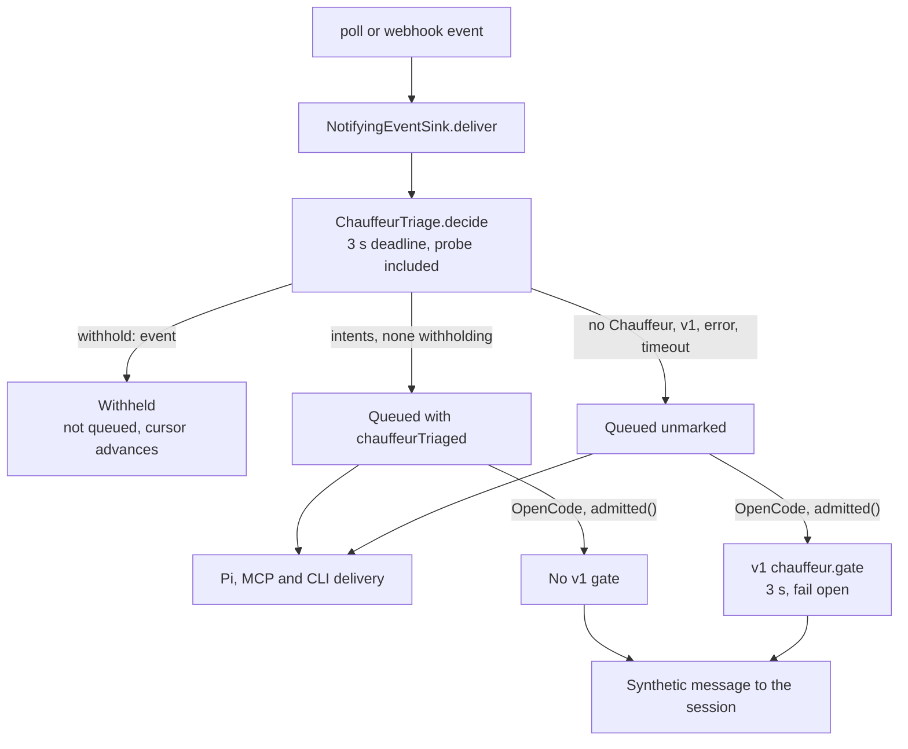

# Chauffeur v2 triage

**Status:** the production connection comes from `@fdcn/chauffeur/client`'s
`connect({ socket })`, pinned to a Chauffeur prerelease tarball and bundled, so the
daemon triages every event before delivery.

Chauffeur v2 triages every event at the daemon's sink,
[`NotifyingEventSink.deliver`](../utils/sink.ts), before the event reaches the queue.
OpenCode, Pi, MCP and the CLI read that one queue, so a withheld event reaches none of
them and a passed event reaches them all.

| Module | Responsibility |
| --- | --- |
| `evidence.ts` | `triageEvidence`: the event, thread and monitor text blocks, each clamped to 16 KiB. |
| `discover.ts` | `candidateSockets`, `probe`, `discover`: which sockets to ask, and whether one answers as Chauffeur v2. |
| `triage.ts` | `ChauffeurTriage`: one kept connection, `decide()` that never rejects, a 3 s deadline over probe and call, one re-probe per 30 s, `close()` on stop. |
| `navigator.ts` | `chauffeurNavigators`, `ChauffeurConnect`: the client's `connect({ socket })` turned into the `Navigator` triage asks, the surface `packages/cli/src/utils/daemon.ts` hands to `ChauffeurTriage`. |

## Discovery

`CHAUFFEUR_SOCKET` names the only socket to try when it is set. Otherwise discovery
tries `<runtime>/chauffeur/daemon.sock` and then
`<runtime>/chauffeur-next/daemon.sock`, where the runtime folder is
`$XDG_RUNTIME_DIR`, or the temporary folder when that is unset. Both names are tried
because a v1 and a v2 daemon can be installed side by side.

A candidate must answer `chauffeur.status` with protocol `1` and a `1.x` version;
prereleases such as `1.0.0-rc.5` count. One reply is read up to 64 KiB and a probe
waits at most 500 ms.

## Rule

`sourcefed setup chauffeur` writes the `sourcefed/triage` rule into
`$XDG_CONFIG_HOME/chauffeur-next/rules/sourcefed/triage.json` (`~/.config` when unset),
which Chauffeur v2 loads on its next rule reload. `--name chauffeur` is refused unless a
Chauffeur v2 daemon answers on that name's socket, because v1 reads the same folder, and an
existing rule file is never overwritten. `sourcefed setup` writes the rule too when
`~/.config/chauffeur-next` exists. [packages/cli/src/utils/chauffeur-rule.ts](../../../cli/src/utils/chauffeur-rule.ts)
holds the canonical rule text.

## Decisions

`decide()` never rejects: a verdict that cannot be had delivers the event. The first
event after startup probes. A working connection is kept, so later events reuse it, and
every event waiting at that moment shares one probe. Discovery runs at most once per
30 s, so a missing daemon costs one probe per interval; stopping the daemon closes the
connection. A connection lost to an `unavailable` rejection or to a call that misses the
deadline is closed, and the next probe waits 30 s from the loss; until then each event
delivers untriaged without waiting, so a hung Chauffeur costs one deadline, not one per
event. Each decide's deadline is a referenced timer, cleared when the decide settles, and
`close()` settles every waiting decide untriaged at once.



- A withhold answers the sink `{ ok: true }` and the event is not queued. The source
  cursor advances, so the verdict is the last word on that event.
- Any other intent, or none at all, queues the event with `chauffeurTriaged: true`.
- With no Chauffeur, a v1 daemon, an error or a timeout, the event queues unmarked.
- A triage that throws or rejects delivers the event unmarked, because the sink catches
  it; only a failed enqueue answers `ok: false`, so the poll keeps its cursor and
  retries: the event is asked again and queued once.
- The mark serves every host. The OpenCode bridge skips its v1 `chauffeur.gate` for a
  marked event and still asks it for an unmarked one, so no event is judged by both
  v2 and v1.

## Evidence

`triageEvidence` builds three text blocks per event. `event` is the event as five lines:

```text
source: github
kind: review
summary: Changes requested on PR #42
body: Please bound the retry loop.
actionable: yes
```

An informational event ends `actionable: no (informational)`, and an event with no body
leaves `body: ` empty. Lines join with newlines.

- `thread` is `"<label>: <title>"`, the label or the title when only one is known, and
  `""` when neither is. The label is the monitor source's `label()`: `#42` for a pull
  request, `ENG-42` for a Jira issue, `thread` or `DM` for Slack, or the joined labels
  of a GitHub issues monitor. The title is `event.subject.title`: a pull-request event
  carries the title its existing GraphQL query and webhook payloads already read, and a
  Jira-issue event carries the summary from its existing issue request, so those threads
  read `#42: feat(cli): add navigate` and `ENG-42: <summary>`; a Slack event carries only
  its label. Both parts are trimmed, and nothing is fetched for the thread itself.
- `monitor` is the source's `describe()`, such as `GitHub wrkhse/chauffeur#42`.

Each block is cut to 16 KiB on a code-point boundary, far under Chauffeur's 256 KiB
evidence limit.

## Request

```ts
const request: TriageRequest = {
  on: "sourcefed.event",
  deadline_ms: 3_000,
  evidence: triageEvidence(monitor, event),
};
```

The reply is `{ intents }`. Only an intent with `withhold: "event"` withholds. An empty
list, or an intent about something else such as `withhold: "notification"`, delivers
the event marked; a reply with no `intents` array delivers it unmarked.

## Failures

Every failure delivers the event unmarked, no more than 3 s late.

| Failure | Outcome |
| --- | --- |
| No socket at any candidate | Delivered unmarked. |
| A v1 daemon, or a reply that is not protocol 1 with a 1.x version | Delivered unmarked. |
| A rejection whose reason is `unavailable` | Delivered unmarked, and the connection is closed. |
| A call that neither answers nor rejects before its deadline | Delivered unmarked at the deadline, and the connection is closed. |
| An error reply, or a rejection other than `unavailable`, such as `limit_exceeded` | Delivered unmarked, and the connection is kept. |
| The 3 s deadline during the probe | Delivered unmarked at the deadline; the probe finishes on its own. |

A rejection whose reason is `unavailable`, and a call that misses its deadline, are
losses: the connection is dropped and closed, the log gets one `went away` line for
each, the next probe waits 30 s from the loss, and until it answers every event is
delivered untriaged at once. A connection that works logs its version and socket once.

## Wiring

The daemon takes triage through `SourcefedDaemonOptions.triage`, and
[packages/cli/src/utils/daemon.ts](../../../cli/src/utils/daemon.ts) is the one place the
wiring lands: it imports `connect` from `@fdcn/chauffeur/client` and passes
`triage: new ChauffeurTriage({ connect: chauffeurNavigators(connect) })`.

The client is a release asset, not a registry package. wrkhse/chauffeur#31 attaches
`fdcn-chauffeur-1.0.0-rc.5.tgz` to each prerelease, the package stays `private: true`, and
`packages/cli/package.json` names that URL as a `devDependency`, so `npm ci` installs it from
GitHub and the bundles carry it. Its sha256 is
`8f24e8ed8f4a6c36ab2238722e90dddf026e8bbbc17f7522aab96798baa26d68`, pinned in the pull request
that added it.

`chauffeur.contract.test.ts` proves the wiring against a real daemon: it points
`XDG_RUNTIME_DIR` and `XDG_CONFIG_HOME` at a temporary folder, writes the rule
`installTriageRule` writes to `<config>/chauffeur-next/rules/sourcefed/triage.json`, starts
`$CHAUFFEUR_BIN` under the name `chauffeur-next` with placeholder models, and asserts that the
sink withholds what the rule refuses and delivers marked what it allows. The check workflow
fetches the pinned `chauffeur-1.0.0-rc.5-linux-x64.tar.gz`, verifies its sha256 and exports
`CHAUFFEUR_BIN`, so the test never skips in the check job and never runs on a developer's machine.

`navigator.ts`'s `ChauffeurConnect` is the client surface this branch was written against, so
if the client's `connect` does not fit it, the shape changed - report it, do not loosen a test
to fit.

## Testing

`evidence.test.ts` covers the three blocks, the thread fallbacks and clamping.
`discover.test.ts` serves status replies from in-process Unix sockets in a temporary
folder, and covers candidate order, `CHAUFFEUR_SOCKET`, v1 and incompatible answers, an
oversized reply and silence. `navigator.test.ts` covers the client seam - the socket
handed to `connect`, one connection per endpoint, and a withhold driven through
`ChauffeurTriage`. `triage.test.ts` uses a fake navigator and clock for the
verdicts, the deadline, the 30 s interval, one probe shared by concurrent events, loss
reporting and `close()`. `runtime-triage.test.ts` runs poll and webhook events through
the sink: a withheld event is not asked again once the cursor advances, a failed enqueue
retries the poll, and a withheld webhook answers success. `stream-triage.test.ts` checks
that a subscriber and the queue record the same mark, over a real SSE round trip.
`sink.test.ts` covers the sink and `daemon-triage.test.ts` the daemon option.
`chauffeur.contract.test.ts` runs the sink against a real daemon, which it starts and stops
with signals, so it skips unless `CHAUFFEUR_BIN` names one; the check workflow sets that from the pinned
platform tarball, and nothing starts a Chauffeur daemon on a developer's machine.
