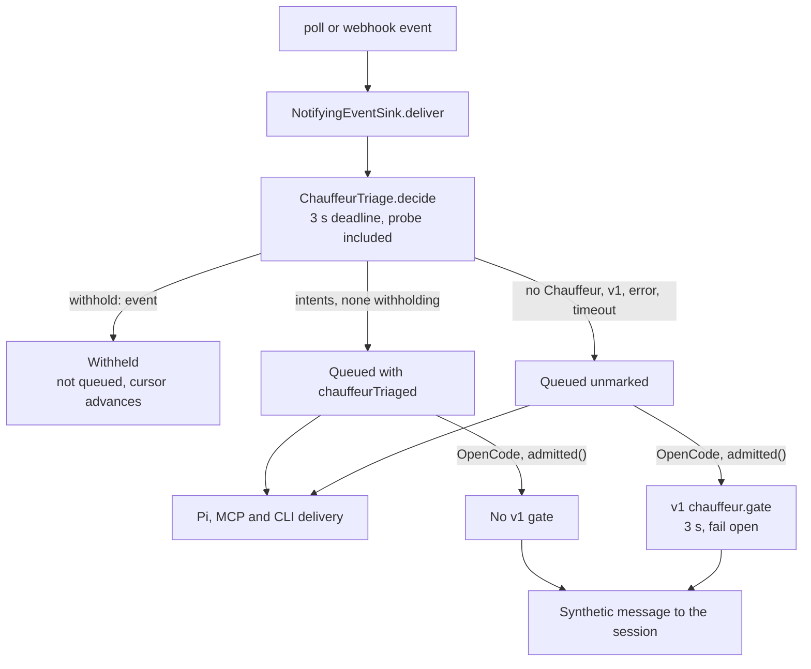

# Chauffeur v2 triage

**Status:** the production connection comes from `@fdcn/chauffeur/client`'s
`connect({ socket })`, pinned to a Chauffeur prerelease tarball and bundled; until that
lands the daemon runs without triage.

Chauffeur v2 triages every event at the daemon's sink,
[`NotifyingEventSink.deliver`](../utils/sink.ts), before the event reaches the queue.
OpenCode, Pi, MCP and the CLI read that one queue, so a withheld event reaches none of
them and a passed event reaches them all.

| Module | Responsibility |
| --- | --- |
| `evidence.ts` | `triageEvidence`: the event, thread and monitor text blocks, each clamped to 16 KiB. |
| `discover.ts` | `candidateSockets`, `probe`, `discover`: which sockets to ask, and whether one answers as Chauffeur v2. |
| `triage.ts` | `ChauffeurTriage`: one kept connection, `decide()` that never rejects, a 3 s deadline over probe and call, one re-probe per 30 s, `close()` on stop. |

## Discovery

`CHAUFFEUR_SOCKET` names the only socket to try when it is set. Otherwise discovery
tries `<runtime>/chauffeur/daemon.sock` and then
`<runtime>/chauffeur-next/daemon.sock`, where the runtime folder is
`$XDG_RUNTIME_DIR`, or the temporary folder when that is unset. Both names are tried
because a v1 and a v2 daemon can be installed side by side.

A candidate must answer `chauffeur.status` with protocol `1` and a `1.x` version;
prereleases such as `1.0.0-rc.4` count. One reply is read up to 64 KiB and a probe
waits at most 500 ms.

## Decisions

`decide()` never rejects: a verdict that cannot be had delivers the event. The first
event after startup probes. A working connection is kept, so later events reuse it, and
every event waiting at that moment shares one probe. Discovery runs at most once per
30 s, so a missing daemon costs one probe per interval; stopping the daemon closes the
connection.



- A withhold answers the sink `{ ok: true }` and the event is not queued. The source
  cursor advances, so the verdict is the last word on that event.
- Any other intent, or none at all, queues the event with `chauffeurTriaged: true`.
- With no Chauffeur, a v1 daemon, an error or a timeout, the event queues unmarked.
- The mark serves every host. The OpenCode bridge skips its v1 `chauffeur.gate` for a
  marked event and still asks it for an unmarked one, so no event is triaged twice.

## Evidence

`triageEvidence` builds three text blocks per event. `event` is the event as five lines:

```text
source: github
kind: review
summary: Changes requested on PR #42
body: Please bound the retry loop.
actionable: yes
```

An informational event ends `actionable: no (informational)`, and an event with no body
leaves `body: ` empty. Lines join with newlines.

- `thread` is `"<label>: <title>"`, the label or the title when only one is known, and
  `""` when neither is. The label is the monitor source's `label()`, such as `#42` for
  a pull request or the joined labels for an issue query. The title is
  `event.subject.title`. Both are trimmed, and nothing is fetched.
- `monitor` is the source's `describe()`, such as `GitHub wrkhse/chauffeur#42`.

Each block is cut to 16 KiB on a code-point boundary, far under Chauffeur's 256 KiB
evidence limit.

## Request

```ts
const request: TriageRequest = {
  on: "sourcefed.event",
  deadline_ms: 3_000,
  evidence: triageEvidence(monitor, event),
};
```

The reply is `{ intents }`. Only an intent with `withhold: "event"` withholds. An empty
list, or an intent about something else such as `withhold: "notification"`, delivers
the event marked; a reply with no `intents` array delivers it unmarked.

## Failures

Every failure delivers the event unmarked, no more than 3 s late.

| Failure | Outcome |
| --- | --- |
| No socket at any candidate | Delivered unmarked. |
| A v1 daemon, or a reply that is not protocol 1 with a 1.x version | Delivered unmarked. |
| A daemon that accepts the connection and stays silent | Delivered unmarked at the probe or deadline timeout. |
| An error reply, or a rejection other than `unavailable`, such as `limit_exceeded` | Delivered unmarked. |
| The 3 s deadline, probe included | Delivered unmarked at the deadline. |

A rejection whose reason is `unavailable` drops the connection, and discovery is capped
at one attempt per 30 s. The log gets one line per loss; a connection that works logs its
version and socket once.

## Testing

`evidence.test.ts` covers the three blocks, the thread fallbacks and clamping.
`discover.test.ts` serves status replies from in-process Unix sockets in a temporary
folder, and covers candidate order, `CHAUFFEUR_SOCKET`, v1 and incompatible answers, an
oversized reply and silence. `triage.test.ts` uses a fake navigator and clock for the
verdicts, the deadline, the 30 s interval, one probe shared by concurrent events, loss
reporting and `close()`. `sink.test.ts` covers the sink and `daemon-triage.test.ts`
the daemon option. Nothing starts a Chauffeur daemon locally.
