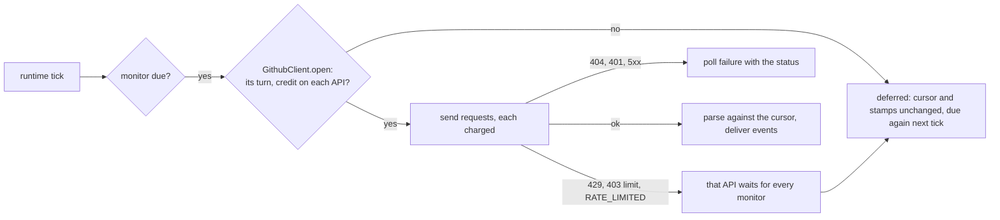

# GitHub API

The GitHub source calls GitHub's REST and GraphQL APIs directly with `GH_TOKEN` or
`GITHUB_TOKEN`. Every request of a poll goes through one `GithubClient`, which charges
the token's budget and turns a rate-limited answer into a wait.

| Module | Does |
| --- | --- |
| `client.ts` | `GithubClient`: one poll's requests; `deferOnWait`; `rateLimitWait` reads a limited answer |
| `github-limiter.ts` | `GithubRateLimiter`: a REST and a GraphQL budget per token, served in turn, each with its own wait |
| `pr.ts` | `fetchPrData`: a pull request's state, reviews and checks, in one GraphQL query and its pages |
| `comments.ts` | `fetchGithubComments`: a REST comment list, up to ten pages |
| `logs.ts` | `fetchJobLog`: a failed Actions job's log, at most 10 MB |

## Rate limits

GitHub gives a token 5000 REST requests an hour and, separately, 5000 GraphQL points an
hour; a pull request query costs one point. The account's other use (`gh`, scripts, CI)
shares both, so every monitor on one token shares a budget of 30 requests a minute of
each API by default (`SOURCEFED_GITHUB_REQUESTS_PER_MINUTE`, read when the daemon starts).

| Setting | Effect |
| --- | --- |
| unset | 30 a minute of each API: 1800 an hour, about a third of the quota |
| above 75 | capped at 75 with a warning: with its burst of 8, no hour starts more than 4508 |
| not a positive number | 30, with a warning |



- A poll is admitted when it is next in line among the monitors no wait holds back and
  every API it uses has a request's credit. A pull request poll uses both APIs, a
  `github-issues` poll only REST, so a GraphQL wait does not hold issue monitors.
- Every request is charged as it is sent, and may leave the credit below zero; later polls
  wait until it is paid back. A pull request poll sends one GraphQL query and two REST
  requests, more for pages, a CI failure (a second query and up to three job logs).
- A rate limit is a 429, a 403 with `x-ratelimit-remaining: 0` or naming a rate limit, or
  a GraphQL `RATE_LIMITED` error. The API waits for `Retry-After`, else until
  `x-ratelimit-reset` when no requests are left, else a minute; at most an hour.
- A wait part-way through a poll defers the whole poll: nothing it read is kept, so the
  cursor moves only after a complete read, and no event is lost or sent twice.
- A wait is logged once, when the monitor that hit the limit asks again (a tick later) or
  the wait ends. The line names the API, the wait, and every monitor using that API that
  asked in the last ten minutes.
- A new monitor's first poll goes to the head of the queue, since it primes the cursor;
  only until its first grant, so a monitor whose polls keep failing then waits its turn.
- The burst holds one 5-second tick's credit plus one, and at least three.
- A missing job log (logs expire) only shortens a CI event; any other failed answer is a
  poll failure naming the status.

### Known limits

- Waits use the wall clock and live in memory: a clock step changes them, and a daemon
  restart forgets them.
- A quota reset is read against this machine's clock, so a skewed clock waits too short
  (GitHub answers again, and the wait starts over) or too long (at most an hour).
- A poll admitted with a request's credit can overdraw by its extra requests, so a busy
  minute can go over the budget by one poll's worth.
- A monitor created during a wait primes after it, so changes made during the wait count
  as already seen.

```ts
const github = GithubClient.open(token, monitorId, ["graphql", "rest"], first)
if (!github) return DEFERRED

return deferOnWait(() => readPullRequest(github, repo, prNumber, cursor, primed))
```
