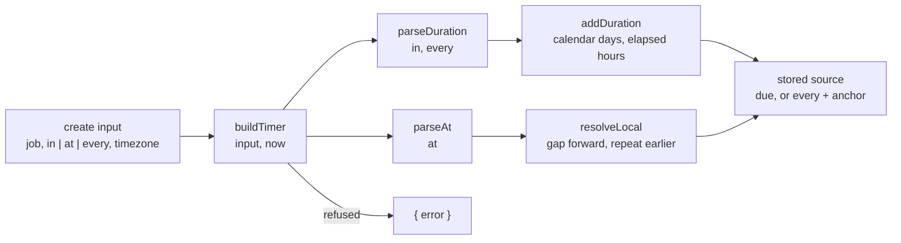

# Timers

The `timer` package reads a timer's create input and resolves it against the
host's clock into the source a monitor stores: a one-shot with its `due`
instant, or an interval with its period and `anchor`. Its modules are pure and
take `now` as an argument. The daemon's registry does not list the timer, and
the package has no poll.



| Module | Responsibility |
| --- | --- |
| `build.ts` | `buildTimer`: checks the input, picks one of `in`, `at` or `every`, and writes the stored source. |
| `durations.ts` | `parseDuration`: `45m`, `1h30m`, `2w`, between 1 minute and 366 days. |
| `at.ts` | `parseAt`: a local time in the zone, or an instant with `Z` or an offset. |
| `zoned.ts` | Time zones through `Intl`: the system zone, checking a name, ISO times with the zone's offset, wall-clock resolution, and adding a duration. |
| `schema.ts` | The source records, the cursor, and the create input. |

## build.ts

`buildTimer` needs `job` and exactly one of `in`, `at` or `every`. The
timezone is the system's when none is given. An `at` already past is kept, to
fire at once; one more than 366 days ahead is refused.

```ts
const now = new Date("2026-11-19T09:30:00Z")

buildTimer({ job: "check the deploy", in: "20m", timezone: "Asia/Kolkata" }, now)
// { type: "timer", job: "check the deploy",
//   due: "2026-11-19T15:20:00+05:30", timezone: "Asia/Kolkata" }

buildTimer({ job: "stretch", every: "45m", timezone: "Asia/Kolkata" }, now)
// { type: "timer", job: "stretch", every: "45m",
//   anchor: "2026-11-19T15:00:00+05:30", timezone: "Asia/Kolkata" }

buildTimer({ job: "x", in: "20m", every: "1h" }, now)
// { error: "give one of in, at or every" }
```

## durations.ts

Units are `w`, `d`, `h` and `m`, in that order, each at most once, with no
spaces. The parser reports the parts; `addDuration` applies them.

```ts
parseDuration("1h30m", "every")
// { weeks: 0, days: 0, hours: 1, minutes: 30 }

parseDuration("30s", "in")
// { error: "in must be at least 1m" }

parseDuration("20 minutes", "in")
// { error: 'in "20 minutes" is not a duration like 45m, 1h30m or 2d' }
```

## at.ts

```ts
parseAt("2026-11-19T15:00", "Asia/Kolkata")
// 2026-11-19T09:30:00.000Z

parseAt("2026-11-19T15:00-05:00", "Asia/Kolkata")
// 2026-11-19T20:00:00.000Z

parseAt("tomorrow", "Asia/Kolkata")
// { error: 'at "tomorrow" is not a time like 2026-11-19T15:00' }
```

## zoned.ts

A wall-clock time the clock skips in spring moves forward by the gap; one the
clock repeats in autumn is the earlier instant. Weeks and days step the
calendar and keep the wall time; hours and minutes are elapsed time.

```ts
const ny = "America/New_York"

zonedIso(resolveLocal({ year: 2026, month: 3, day: 8, hour: 2, minute: 30, second: 0 }, ny), ny)
// "2026-03-08T03:30:00-04:00"

const saturday = new Date("2026-03-07T09:00:00-05:00")

zonedIso(addDuration(saturday, { weeks: 0, days: 1, hours: 0, minutes: 0 }, ny), ny)
// "2026-03-08T09:00:00-04:00"

zonedIso(addDuration(saturday, { weeks: 0, days: 0, hours: 24, minutes: 0 }, ny), ny)
// "2026-03-08T10:00:00-04:00"

checkTimezone("Mars/Olympus")
// { error: 'timezone "Mars/Olympus" is not an IANA time zone' }
```

## schema.ts

```ts
v.parse(TimerSourceSchema, {
  type: "timer",
  job: "stretch",
  every: "45m",
  anchor: "2026-11-19T15:00:00+05:30",
  timezone: "Asia/Kolkata",
})
```

The cursor, `{ checkedAt }`, is the instant up to which firings have been
considered.
