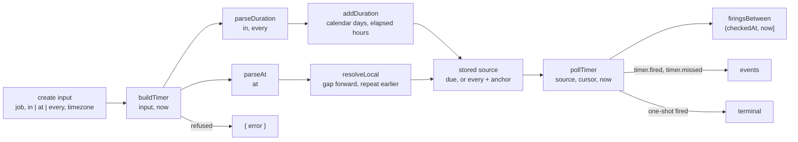

# Timers

The `timer` package reads a timer's create input and resolves it against the
host's clock into the source a monitor stores: a one-shot with its `due`
instant, or an interval with its period and `anchor`. Each poll compares the
stored source with the host's clock and returns `timer.fired` or
`timer.missed`; a one-shot's firing ends its monitor. Its modules are pure and
take `now` as an argument. `TimerMonitor` is the source as a core monitor,
registered under `timer` in the daemon.

Timer monitors require sourcefed 0.6.0-rc.2 or later. The [0.6.0-rc.3
release][rc3] provides a candidate tarball and checksums. With a compatible
CLI and daemon:

```sh
sourcefed monitor create --name deploy --source-type timer \
  --job "check the deploy" --in 20m --timezone Asia/Kolkata
```



| Module | Responsibility |
| --- | --- |
| `monitor.ts` | `timerSource`, the source definition, and `TimerMonitor`, the monitor made from it. |
| `poll.ts` | `pollTimer`: one poll at `now`, its events, cursor and whether the monitor ends. |
| `firings.ts` | `firingsBetween`: how many firings of an interval fall in a window, and the latest. |
| `events.ts` | `timerKey`, `firedEvent` and `missedEvent`. |
| `build.ts` | `buildTimer`: checks the input, picks one of `in`, `at` or `every`, and writes the stored source. |
| `durations.ts` | `parseDuration`: `45m`, `1h30m`, `2w`, between 1 minute and 366 days. |
| `at.ts` | `parseAt`: a local time in the zone, or an instant with `Z` or an offset. |
| `zoned.ts` | Time zones through `Intl`: the system zone, checking a name, ISO times with the zone's offset, wall-clock resolution, and adding a duration. |
| `schema.ts` | The source records, the cursor, and the create input. |

## monitor.ts

`timerSource` builds with the host's clock and polls with it. Its key holds the
due time or the anchor, so two timers made at different times are two monitors.
It polls every 15 seconds by default.

```ts
const monitor = defineSource(timerSource, { http, mcp, now: () => clock })
// clock is 2026-11-19T15:00:00+05:30

const source = monitor.build({ job: "check the deploy", in: "20m", timezone: "Asia/Kolkata" })

monitor.key(source)
// "timer:check the deploy:2026-11-19T15:20:00+05:30"

monitor.describe(source)
// "Timer check the deploy (at 2026-11-19T15:20:00+05:30)"
```

## poll.ts

A one-shot fires once `now` reaches `due` and the poll is terminal; found more
than two minutes after `due` it carries `late`, `lateSec` and the delay in its
summary, in its two largest units, such as `45m`, `3h 20m` or `2d 4h`. An interval reads the firings in (`checkedAt`, `now`], or from the
anchor when there is no cursor: one found on time is `timer.fired`, more than
one or a late one is a single `timer.missed` naming the count and the latest.
An interval whose cursor is missing or corrupt counts its window from the
anchor, so it gives at most one event, never a flood. An event's id is fixed by
its firing, `timer:<key>:<at>`, whatever its kind, so a repeated poll repeats it
and the queue keeps one.

```ts
const oneShot = { type: "timer", job: "check the deploy", due: "2026-11-19T15:20:00+05:30", timezone: "Asia/Kolkata" }

pollTimer(oneShot, null, new Date("2026-11-19T18:20:00+05:30"))
// { events: [timer.fired, "… fired at 2026-11-19T15:20:00+05:30, 3h late"], terminal: true }

const stretch = { type: "timer", job: "stretch", every: "45m", anchor: "2026-11-19T09:00:00+05:30", timezone: "Asia/Kolkata" }

pollTimer(stretch, { checkedAt: "2026-11-19T09:10:00+05:30" }, new Date("2026-11-19T12:50:00+05:30"))
// { events: [timer.missed, count 5, latest 2026-11-19T12:45:00+05:30], terminal: false }
```

## firings.ts

The k-th firing is k periods from the anchor, so calendar steps never drift.
The count is estimated from the nominal period and corrected a step at a time,
so a year's gap costs the same as a minute's. A stored `every` that does not
parse is a broken record: it throws core's `PollSourceError`, which the tick
logs as one line.

```ts
firingsBetween(stretch, new Date("2026-11-19T09:10:00+05:30"), new Date("2026-11-19T12:50:00+05:30"))
// { latest: 2026-11-19T07:15:00.000Z, count: 5 }
```

## build.ts

`buildTimer` needs `job` and exactly one of `in`, `at` or `every`. The
timezone is the system's when none is given. An `at` already past is kept, to
fire at once; one more than 366 days ahead is refused.

```ts
const now = new Date("2026-11-19T09:30:00Z")

buildTimer({ job: "check the deploy", in: "20m", timezone: "Asia/Kolkata" }, now)
// { type: "timer", job: "check the deploy",
//   due: "2026-11-19T15:20:00+05:30", timezone: "Asia/Kolkata" }

buildTimer({ job: "stretch", every: "45m", timezone: "Asia/Kolkata" }, now)
// { type: "timer", job: "stretch", every: "45m",
//   anchor: "2026-11-19T15:00:00+05:30", timezone: "Asia/Kolkata" }

buildTimer({ job: "x", in: "20m", every: "1h" }, now)
// { error: "give one of in, at or every" }
```

## durations.ts

Units are `w`, `d`, `h` and `m`, in that order, each at most once, with no
spaces. The parser reports the parts; `addDuration` applies them.

```ts
parseDuration("1h30m", "every")
// { weeks: 0, days: 0, hours: 1, minutes: 30 }

parseDuration("30s", "in")
// { error: "in must be at least 1m" }

parseDuration("20 minutes", "in")
// { error: 'in "20 minutes" is not a duration like 45m, 1h30m or 2d' }
```

## at.ts

```ts
parseAt("2026-11-19T15:00", "Asia/Kolkata")
// 2026-11-19T09:30:00.000Z

parseAt("2026-11-19T15:00-05:00", "Asia/Kolkata")
// 2026-11-19T20:00:00.000Z

parseAt("tomorrow", "Asia/Kolkata")
// { error: 'at "tomorrow" is not a time like 2026-11-19T15:00' }
```

## zoned.ts

A wall-clock time the clock skips in spring moves forward by the gap; one the
clock repeats in autumn is the earlier instant. Weeks and days step the
calendar and keep the wall time; hours and minutes are elapsed time.

```ts
const ny = "America/New_York"

zonedIso(resolveLocal({ year: 2026, month: 3, day: 8, hour: 2, minute: 30, second: 0 }, ny), ny)
// "2026-03-08T03:30:00-04:00"

const saturday = new Date("2026-03-07T09:00:00-05:00")

zonedIso(addDuration(saturday, { weeks: 0, days: 1, hours: 0, minutes: 0 }, ny), ny)
// "2026-03-08T09:00:00-04:00"

zonedIso(addDuration(saturday, { weeks: 0, days: 0, hours: 24, minutes: 0 }, ny), ny)
// "2026-03-08T10:00:00-04:00"

checkTimezone("Mars/Olympus")
// { error: 'timezone "Mars/Olympus" is not an IANA time zone' }
```

## schema.ts

```ts
v.parse(TimerSourceSchema, {
  type: "timer",
  job: "stretch",
  every: "45m",
  anchor: "2026-11-19T15:00:00+05:30",
  timezone: "Asia/Kolkata",
})
```

The cursor, `{ checkedAt }`, is the instant up to which firings have been
considered.

[rc3]: https://github.com/wrkhse/sourcefed/releases/tag/v0.6.0-rc.3
