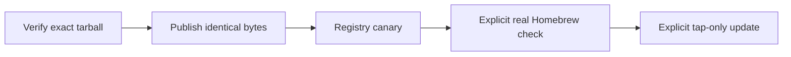

# Release commands

Status: In progress. Publication and real Homebrew validation require operator
authorization. See the [release contract](../../docs/e2e-release-plan.md).



| Module | Responsibility |
| --- | --- |
| `verify.mjs` | Pack once, isolate gates, retain manifest and logs |
| `artifact.mjs` | Reject missing gates, changed source and changed artifact bytes |
| `publish.mjs` | Opt-in authenticated push/publication after verification |
| `registry.mjs` | Resume the postpublication registry canary; adopt a CI-repacked tarball with the same tar |
| `homebrew.mjs` | Explicit-consent upgrade, test and keep, or exact rollback |
| `pins.mjs` | Independent tap, dotfiles and Pi selectors |
| `tooling.test.mjs` | Fail-closed, isolation, tampering and selector tests |

Start with a mutation-free candidate check:

```sh
npm run release:verify -- --dry-run
```

After authorized publication and registry verification:

```sh
npm run release:homebrew -- --confirm-real-homebrew

npm run release:pins -- --tap
```

`assertPublishable(record, state, version)` binds required passing gates to a
clean source snapshot and the candidate SHA-256. `assertPinsAllowed` requires
registry proof and artifact-bound Homebrew proof for tap updates. Homebrew
upgrades the installed Sourcefed from the candidate formula in the local tap
checkout, restores that file, and keeps the new keg only after `brew test` and
`skills list` pass. Failure relinks the previous keg; other formulae never change.

Run safety tests independently with:

```sh
node --test scripts/release/tooling.test.mjs
```

## Candidates and final releases

Pushing a tag runs [release.yml](../../.github/workflows/release.yml), and the
tag picks the job:

| Tag | Job | Result |
| --- | --- | --- |
| `v0.6.0-rc.1`, any tag with a `-` | `candidate` | GitHub prerelease only |
| `v0.6.0` | `publish` | Staged on npm for approval |

`candidate` runs `npm run check`, packs `@fdcn/sourcefed`, and publishes a
GitHub prerelease with the tarball and its `SHA256SUMS`; nothing goes to npm.
`publish` runs the same check and stages the package on npm for approval.

The local scripts (`pins`, `homebrew`, `registry`, `publish`) are for final
releases. `pins`, `homebrew` and `publish` match final versions only
(`[\d.]+`), and `registry` checks npm, which holds no candidate.

## Publishing a candidate to npm under `rc`

Pushing a candidate tag still only creates the prerelease. To put a verified
candidate on npm, dispatch [release.yml](../../.github/workflows/release.yml)
manually. This path is **for candidates only**: the version must be a
prerelease such as `0.6.0-rc.3`, and the `latest` dist-tag is never changed.

One-time prerequisites, owned by the release maintainer:

- The protected `release-rc` GitHub environment, with the owner as its required
  reviewer, exists before the dispatch. The job waits for that approval. The
  `release` environment stays tag-only for final publishes.
- npm trusted publishing is configured for `wrkhse/sourcefed`, workflow
  file `release.yml`, environment `release-rc`, with direct `npm publish` allowed.
  If the trusted publisher is already bound to `release`, delete and recreate it
  with `release-rc`: npm cannot edit an existing connection.
  No npm token is passed; OIDC authenticates the job and npm adds provenance.

Steps:

1. Confirm the prerelease `v<version>` carries exactly
   `fdcn-sourcefed-<version>.tgz` and `SHA256SUMS`.
2. In the repository's Actions tab, select **Release** → **Run workflow**, then
   enter `version` as `0.6.0-rc.3` and `tag` as `v0.6.0-rc.3` (the tag must be
   exactly `v` plus the version) and run it.
3. Approve the `release-rc` deployment under **Review deployments**. The job does
   not publish without that approval.
4. The `publish-rc` job checks out the tag, downloads both assets from the
   prerelease, verifies the tarball with `shasum -a 256 -c SHA256SUMS`, refuses
   a version already on npm (especially one with different bytes), then
   publishes that exact tarball with
   `npm publish --tag rc --access public --provenance`. It checks that `latest`
   is unchanged and that `rc` points at the dispatched version.
5. Confirm with `npm view @fdcn/sourcefed dist-tags`.

Every check fails closed: bad inputs, a missing asset, a checksum mismatch, or
an existing version stops the job with a clear message and no retry. A failed
or unapproved run is not proof of publication — check npm before considering
anything else. Do not use this path for a final version, and do not rerun a
version already published. Final releases keep using the tag-driven `publish`
job; candidate prereleases keep using `candidate`.
